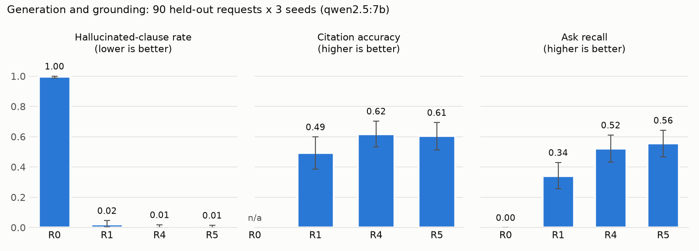
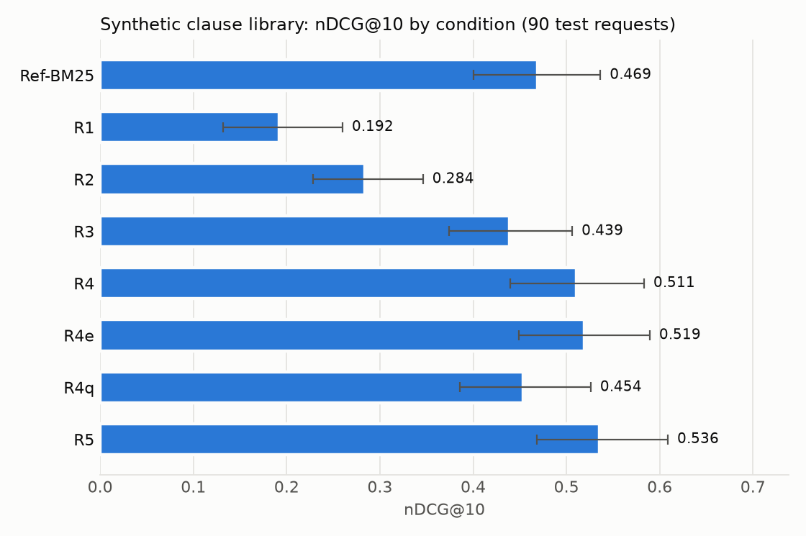
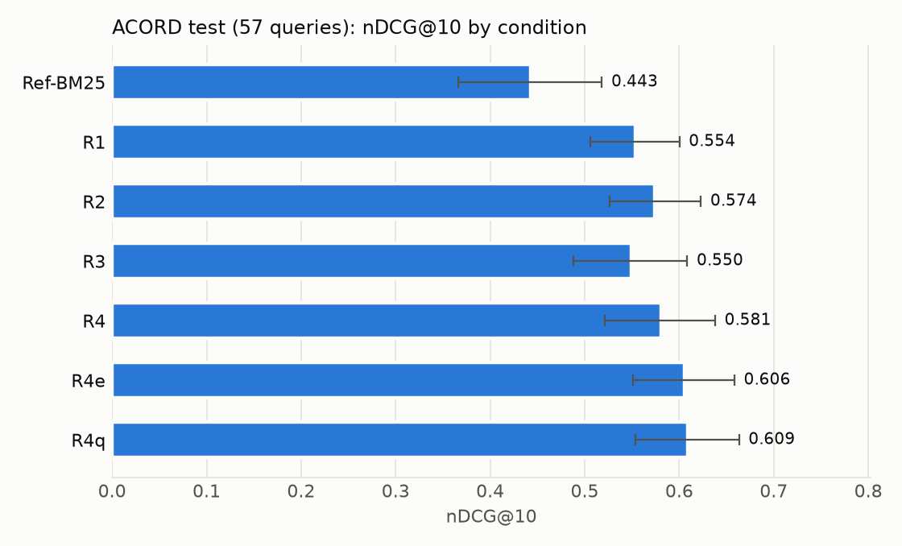
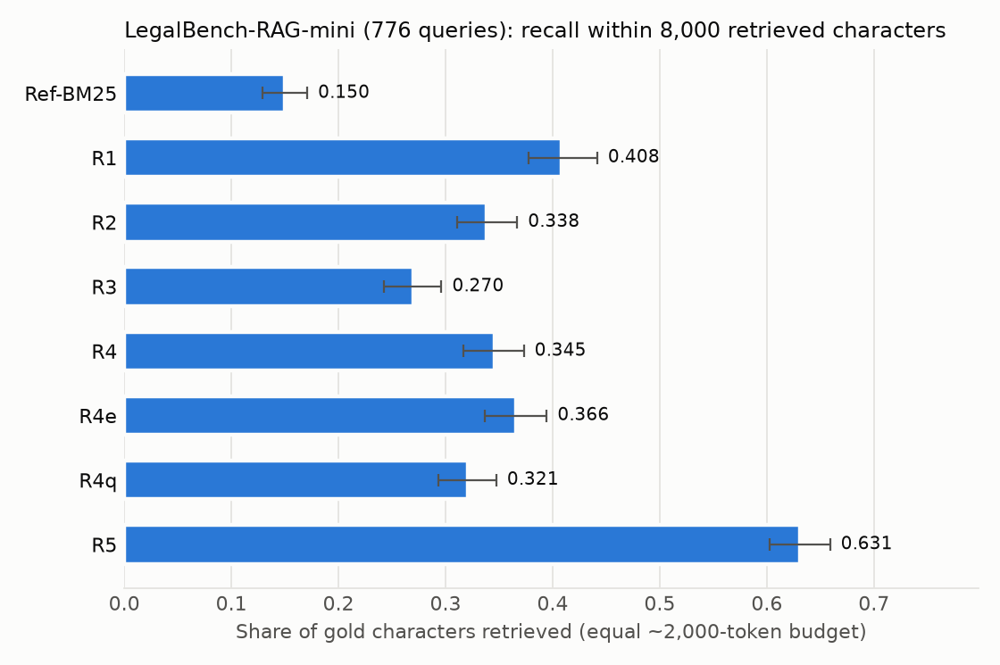
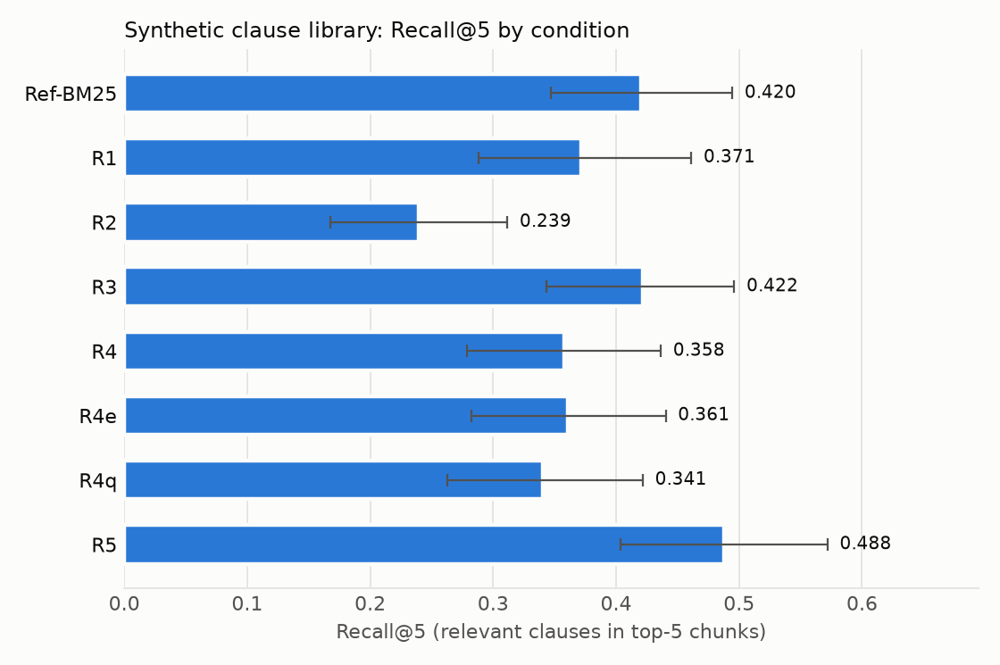
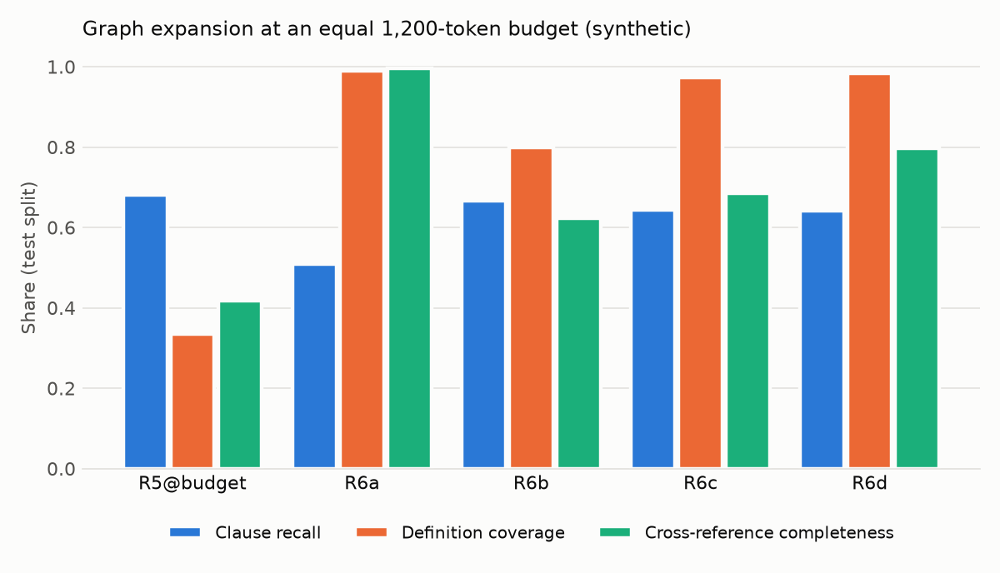
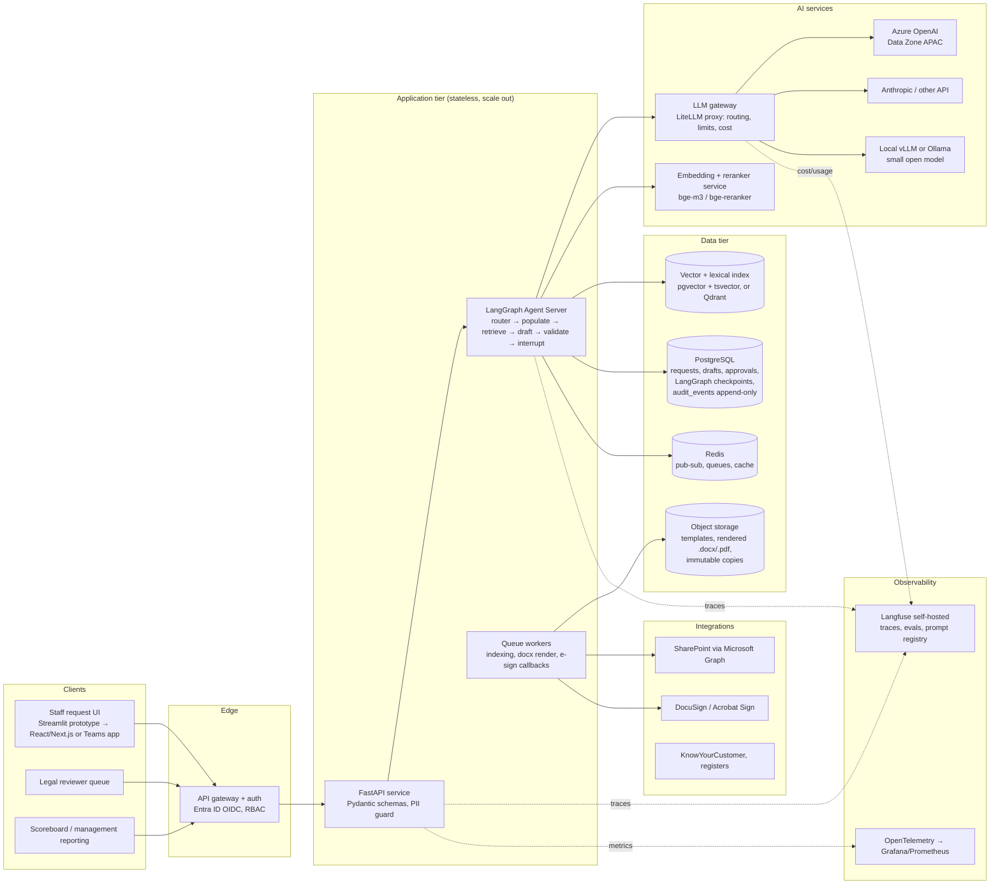

# Legal Agreement AI — Research README

**Project:** AI-assisted legal agreement generation and workflow automation for a MAS-regulated fund manager (Singapore).
**Companion document:** [docs/project-plan.md](docs/project-plan.md) (the group-assignment plan: experiments, datasets, timeline, team roles).
**Status:** research notes, 16 October 2026. **Experiment 3 (retrieval pipeline) is now implemented and has been run locally**: see [Running Experiment 3](#running-experiment-3-locally) and [docs/experiment3-results.md](docs/experiment3-results.md). Experiments 1 and 2 (skill files, agent harness) are not implemented yet.

This README answers two research questions that the project plan left open:

1. **Which end-to-end tech stack should we design around if the prototype has to become a real, deployable, scalable production system?** (Part 1)
2. **What is an "A\*" approach to legal RAG, what does the literature actually say, and how would we build and test one for clause retrieval and draft assembly?** (Part 2)

Every claim that came from a web source is linked. Claims first seen only in secondary sources were tagged **[unverified]**. On 16 October 2026 each one was checked against a primary source (full paper PDFs, official docs, NVD, GitHub API), and its tag was either removed or replaced with a correction; section 3 records what was confirmed, what was corrected and the one item that could not be verified. Rows that cite editorial or vendor sources without a tag (for example the markaicode, DEV and pkgpulse pages) were not part of that check.

---

## Results by research question

The project has five research questions: RQ1–RQ3 from the [project plan](docs/project-plan.md#3-objectives-and-research-questions) and the two this README adds. Only Experiment 3 has been run, so only some of them have measured answers so far.

| Research question | Status | Evidence | Short answer |
|---|---|---|---|
| **RQ1** (plan): does a `SKILL.md` playbook improve drafting over a vanilla LLM? | Not run yet | Experiment 1 (planned) | – |
| **RQ2** (plan): does an agent harness outperform a single LLM call? | Not run yet | Experiment 2 (planned) | – |
| **RQ3** (plan): does a stronger retrieval pipeline improve accuracy and grounding? | **Answered** | Experiment 3: three benchmarks and a grounding eval | **Yes**, below |
| **Q2** (README): does A\*-guided clause-graph retrieval help? | **Partly answered** | Experiment 3, conditions R6a–R6d | **Yes for self-contained evidence; no against plain BFS**, below |
| **Q1** (README): which production stack? | Design question, no benchmark | Part 1; Experiment 3 sets the retrieval configuration | See Part 1 |

All numbers come from [docs/experiment3-results.md](docs/experiment3-results.md), with paired significance tests in [`eval/results/exp3/significance.md`](eval/results/exp3/significance.md). "Significant" means the 95% paired bootstrap CI of the difference excludes zero.

### RQ3 — Does a stronger retrieval pipeline improve accuracy and grounding?

**Answer: yes.** Compared with naive RAG (R1), the hybrid + reranker pipeline (R4) and its contextual-chunk version (R5) retrieve the requested clauses better on our use case. They also make the drafting model cite approved clauses instead of inventing them.

| Benchmark | Queries | Metric | No retrieval (R0) | Naive RAG (R1) | Hybrid + reranker (R4) | + contextual chunks (R5) |
|---|---|---|---|---|---|---|
| Synthetic clause library (Singapore context) | 90 held-out requests | nDCG@10 | – | 0.192 | 0.511 | **0.536** |
| Synthetic clause library | 90 | Recall@5 | – | 0.371 | 0.358 | **0.488** |
| [ACORD](https://huggingface.co/datasets/theatticusproject/acord) (attorney-rated clause retrieval) | 57 test queries | nDCG@10 | – | 0.554 | 0.581 (0.606 with Qwen3-Embedding, R4e) | not run (no parent documents) |
| [LegalBench-RAG-mini](https://github.com/zeroentropy-ai/legalbenchrag) (span retrieval) | 776 | Recall within 8,000 retrieved characters | – | 0.408 | 0.345 | **0.631** |
| Grounding eval (qwen2.5:7b, 3 seeds) | 90 held-out requests | Hallucinated-clause rate (lower is better) | 0.995 | 0.019 | 0.008 | **0.006** |
| Grounding eval | 90 | Ask recall (requested clauses correctly cited) | 0.000 | 0.340 | 0.521 | **0.556** |
| Grounding eval | 90 | Citation accuracy | – | 0.493 | **0.617** | 0.606 |



<p>
  
  
</p>
<p>
  
  
</p>

- **Retrieval is what makes grounded drafting possible.** Without the library, 99.5% of drafted clauses cannot be traced to an approved clause. With any retrieval it is 2% or less (R1 vs R0: −0.976, significant).
- **The full pipeline beats naive RAG.** On our requests, nDCG@10 is +0.32 for R4 over R1, and ask recall is +0.18 (significant), while R4 shows the model one sixth of the context (5 clauses vs about 31). The citation-accuracy gain (+0.11) is borderline, with a CI that just includes zero.
- **Contextual enrichment is the strongest single lever.** It roughly doubles LegalBench-RAG recall at an equal budget and triples precision@1. On our requests it lifts Recall@5 by +0.13 (significant).
- **What did not help:** BM25 hybrid hurts on LegalBench-RAG's formal queries (it helps on staff requests). The doctrinal query rewrite (R4q) with a local 7B model is significantly worse on two of three datasets. Swapping in Qwen3-Embedding (R4e) gives only a small gain.
- **External reference points:** on ACORD, our scores sit in the paper's range. BGE-M3 dense scores 0.574, against 0.641 for OpenAI-large in the paper. GPT-4o reranking (0.797 in the paper) is the gap still to close.

### README Q2 — Does A\*-guided clause-graph retrieval help?

**Answer: it makes the evidence self-contained, but it does not beat plain BFS on definitions, as hypothesised.** All conditions get the same 1,200-token budget on the synthetic test split.

| Condition | Clause recall | Definition coverage | Cross-reference completeness | Legal requirements satisfied |
|---|---|---|---|---|
| R5 flat retrieval (same budget) | **0.682** | 0.334 | 0.418 | 0.431 |
| R6a BFS depth 2 | 0.508 | **0.990** | **0.996** | 0.690 |
| R6c A\*, admissible heuristic | 0.644 | 0.974 | 0.685 | 0.950 |
| R6d A\*, tuned heuristic | 0.642 | 0.984 | 0.796 | **0.979** |



- A\* raises definition coverage by +0.64 over flat retrieval at the same budget, with no significant loss of the requested clauses (clause recall −0.04, not significant). The drafter receives each clause together with the definitions and linked clauses it depends on.
- The pre-registered hypothesis "A\* beats BFS on definition coverage and cross-reference completeness" is **rejected**. BFS scores higher on both, but it finds about a fifth fewer of the requested clauses (0.508 vs 0.644) and satisfies fewer legal requirements (0.690 vs 0.950).
- The heuristic tuned on dev is inadmissible and better (+0.11 cross-reference completeness, significant). This matches the Distance-Indexed Neural A\* paper (section 2.2).

### README Q1 — Production stack

There is no benchmark for this question. It is answered by design in [Part 1](#part-1--production-tech-stack-end-to-end). Experiment 3 changes one decision: the release-gate retrieval configuration becomes **R5 + R6d** (hybrid search, reranker, contextual chunks, then A\* graph expansion) instead of R4 (section 1.5).

### RQ1 and RQ2 — not run yet

Experiments 1 (skill files, conditions S0–S5) and 2 (agent harness, conditions H0–H4) are designed in the [project plan](docs/project-plan.md#5-experiment-design) but not implemented. They would reuse the same synthetic requests, which already exist, and the same Scoreboard metrics. The plan's planted-defect labels (missing fields, conflicting dates, fee out of range and others) still need to be added to `data/synthetic/requests.jsonl` before Experiment 2 can measure defect recall.

---

## Running Experiment 3 locally

Experiment 3 compares retrieval pipelines against no retrieval and naive RAG (plan section 5.4, README 2.4.4 and 2.7). It runs on one machine. The reference run used Windows 11, an RTX 4060 laptop GPU (8 GB) and 16 GB RAM. All LLM steps use a local model through [Ollama](https://ollama.com), so no API key is needed and no data leaves the machine.

| What | Where |
|---|---|
| Synthetic clause library (129 clauses, 5 templates, Singapore context) and 120 staff requests with graded gold labels | `scripts/clause_catalog.py`, `scripts/build_synthetic.py`, `data/synthetic/` |
| Public benchmarks: ACORD (test split, 57 queries) and LegalBench-RAG-mini (776 queries, rebuilt and checked against the paper's Table 3) | `scripts/download_public.py` → `data/public/` (not committed) |
| Conditions R1–R6d, including R4e (embedder swap) and R4q (doctrinal query rewrite) | `configs/experiments/exp3.yaml`, `src/retrieval/` |
| Retrieval metrics (Recall@k, MRR, nDCG, LegalBench-RAG character P/R, ACORD star precision) and graph metrics | `eval/metrics/retrieval_metrics.py`, `src/retrieval/graph.py` |
| Generation and grounding eval (citation accuracy, hallucinated-clause rate, claim support, per-requirement abstention) | `eval/generation_eval.py` |
| Results | `eval/results/exp3/`, write-up in [docs/experiment3-results.md](docs/experiment3-results.md) |

```bash
uv venv .venv --python 3.11
```
```bash
uv pip install --python .venv/Scripts/python.exe torch==2.6.0 --index-url https://download.pytorch.org/whl/cu124
```
```bash
uv pip install --python .venv/Scripts/python.exe -r pyproject.toml --extra dev
```
```bash
ollama pull qwen2.5:7b
```
```bash
.venv/Scripts/python.exe scripts/download_public.py
```
```bash
.venv/Scripts/python.exe scripts/build_synthetic.py
```
```bash
.venv/Scripts/python.exe eval/run_experiment.py
```
```bash
.venv/Scripts/python.exe eval/generation_eval.py
```
```bash
.venv/Scripts/python.exe eval/significance.py
```
```bash
.venv/Scripts/python.exe eval/plot_results.py
```
```bash
.venv/Scripts/python.exe -m pytest -q
```

On Linux or macOS, use `.venv/bin/python`. Without an NVIDIA GPU, install the CPU build of torch; the run then takes considerably longer. On the reference laptop a full run from an empty cache takes about 4 hours, mostly local LLM calls:

- about 1.6 h of query rewrites and contextual summaries;
- about 35 min of retrieval;
- about 2 h for the generation eval (90 test requests × 4 conditions × 3 seeds, about 6.6 s per call).

LLM outputs, embeddings and reranker scores are cached in `.cache/`, so reruns take minutes.

**Results:** see [Results by research question](#results-by-research-question) above, and [docs/experiment3-results.md](docs/experiment3-results.md) for the full write-up.

---

## 0. Why the stack matters: what the client environment tells us

The ICHAM internship description (FinTech Intern, Legal & Compliance, Oct/Nov 2026 to 31 May 2027) is the closest thing we have to a requirements document. The lines that constrain architecture:

| Requirement in the job description | Architectural consequence |
|---|---|
| "Any use of AI, automation or third-party technology must be conducted using approved tools and in accordance with ... information security, data protection, confidentiality and AI governance requirements" | We cannot assume an arbitrary SaaS LLM. Design for a **swappable model provider behind a gateway**, with a data-residency option and a no-training-on-inputs contract. |
| "Exploring integration with existing document management, SharePoint and electronic-signature processes" | The firm runs **Microsoft 365**. Templates, drafts and executed agreements live in **SharePoint**. Plan for **Microsoft Graph** and an **e-signature API** (DocuSign or Adobe Acrobat Sign). |
| "Developing appropriate audit trails and management reporting" | An **append-only audit store** and a reporting view are first-class components, not logging afterthoughts. |
| "Developing workflow routing for Legal review, approval and escalation" and "All documents generated ... remain subject to appropriate Legal review and approval before execution" | **Human-in-the-loop is mandatory**. The workflow engine must pause durably (hours to days) and resume on a human decision. |
| "Supporting the tracking of draft status, approvals, execution and document versions" | Versioned **state store** for requests, drafts, approvals; template and clause **version pinning**. |
| "Migration ... from SharePoint to the KnowYourCustomer system", "Outsourcing Service Provider Register" | The same platform will be reused for other Compliance automations. Keep **workflow definitions and integrations generic**, not NDA-specific. |

Two regulatory facts changed since the project plan was written:

- **MAS issued the final Guidelines on AI Risk Management on 7 October 2026.** They apply to all financial institutions and all forms of AI, including generative AI and AI agents. Sections 3 and 4 (oversight, AI identification, inventory, risk materiality) apply from 7 October 2027; Sections 5 and 6 (life-cycle controls, capability) by 7 October 2028. Source: [MAS media release](https://www.mas.gov.sg/news/media-releases/2026/mas-sets-out-supervisory-expectations-on-responsible-ai-adoption-by-financial-institutions), [guidelines page](https://www.mas.gov.sg/regulation/guidelines/guidelines-on-artificial-intelligence-risk-management-for-financial-institutions), [PDF](https://www.mas.gov.sg/-/media/mas-media-library/regulation/guidelines/bd/guidelines-on-artificial-intelligence-risk-management-for-financial-institutions/guidelines-on-artificial-intelligence-risk-management.pdf). The project plan still says "proposed"; update it.
- The guidelines explicitly list "copilots to assist in writing" and "AI to assist in the initial review or analysis of documents for internal reference" as **lower-materiality** uses, *provided humans review and check outputs before use* (guidelines, section 2, footnotes 12 and 13). Our design should be able to demonstrate that condition. Paragraph 5.9 (human oversight) asks for escalation when "pre-defined conditions (e.g., on reliability and accuracy) are met", for logs of oversight decisions, and for review of near misses. Paragraph 5.17 (reproducibility and auditability) asks for documentation of data sources, selection rationale, code versions and environments, evaluation thresholds and results. Paragraph 5.18 asks for pre-deployment review by people not involved in development. Footnote 46 says generative AI testing should pay particular attention to hallucination and prompt injection, pointing to IMDA's Starter Kit for Testing LLM-Based Applications.

The Scoreboard, the audit log and the validation engine in the project plan already map onto those paragraphs. Part 1 makes the mapping explicit (section 1.6).

---

## Part 1 — Production tech stack, end to end

### 1.1 Design principles

1. **Deterministic where possible, LLM where necessary.** Template choice, field filling, date and fee checks are code. The LLM handles free text, clause selection and explanations. (Already in the plan; it is also the cheapest way to satisfy MAS explainability expectations.)
2. **Every AI call goes through one gateway.** One place for provider switching, rate limits, cost accounting, PII masking, prompt versioning and tracing.
3. **Durable, resumable workflows.** A draft waiting for Legal approval must survive deployments and restarts without holding a process open.
4. **Append-only audit, versioned everything.** Templates, clauses, prompts, model IDs, skill files and routing policies carry versions that are written into every audit event.
5. **Same code from laptop to cluster.** Docker Compose for the prototype, the same images under Kubernetes for production. No serverless for the agent server (see 1.4).
6. **Evaluation as a release gate.** The Scoreboard is not only a research artefact; a subset of it runs in CI and blocks a deploy if hallucinated-clause rate or defect recall regresses.

### 1.2 Reference architecture


<details>
<summary>Mermaid source (edit <code>docs/figures/architecture.mmd</code>, then re-render the PNG)</summary>



Re-render with mermaid-cli. On the first run, npx downloads mermaid-cli and a headless Chromium; to reuse an installed Chrome instead, pass `-p` with a puppeteer config that sets `executablePath`.

```bash
npx -y @mermaid-js/mermaid-cli@11.4.2 -i docs/figures/architecture.mmd -o docs/figures/architecture.png -c docs/figures/mermaid-config.json -b white -s 2 -w 1400
```

</details>

Grey/blue/orange colouring from the plan still applies: deterministic code, LLM, human checkpoints. The "Experiment Switchboard" (skill, harness mode, retrieval mode) becomes **configuration served by the API**, so production and research runs share one code path.

### 1.3 Layer-by-layer choices

The prototype column is what the group builds in six weeks. The production column is what we would recommend ICHAM deploy, and the architecture must not block the move.

| Layer | Prototype (6 weeks) | Production target | Why / evidence |
|---|---|---|---|
| **Language, runtime** | Python 3.11+, `uv` or Poetry, Docker | Same | Whole AI ecosystem is Python-first; LangGraph, Langfuse, Presidio, docxtpl all Python. |
| **API** | FastAPI + Pydantic v2 | FastAPI behind an API gateway (Azure API Management, Kong, or NGINX ingress) with Entra ID OIDC | Stateless tier scales horizontally; auth is not built into the open-source LangGraph server, so put it in front ([search summary](https://theneuralbase.com/langgraph/learn/advanced/when-to-self-host-vs-use-langgraph-cloud/)). |
| **Orchestration** | LangGraph (Python library, in-process, SQLite/Postgres checkpointer, `interrupt()` for review) | **LangGraph Agent Server, standalone, on Kubernetes via Helm**; optional **Temporal** wrapper for long-lived approvals | Official docs: standalone server needs Postgres + Redis, Helm/K8s is the only regularly tested production path, Docker is for small workloads, and serverless is forbidden because scale-to-zero loses tasks. A `LANGGRAPH_CLOUD_LICENSE_KEY` and reachability to `beacon.langchain.com` are required unless air-gapped. ([LangChain docs](https://docs.langchain.com/langsmith/deploy-standalone-server)) Licensing: the standalone server is one of three self-hosted topologies, and "self-hosted deployments require an Enterprise plan and the LangSmith license key delivered with that plan" ([self-hosted overview](https://docs.langchain.com/langsmith/deploy-to-self-hosted-overview)). Air-gapped mode removes the beacon egress but needs a separate offline (air-gapped) licence from LangChain sales; billing telemetry cannot otherwise be disabled ([egress docs](https://docs.langchain.com/langsmith/self-host-egress)). Only the LangGraph library is MIT-licensed and free. |
| **Durable execution** | Not needed | Temporal's LangGraph plugin (Python, public preview, July 2026): nodes run as activities, `interrupt()` pauses durably for days, resumes via signal | LangGraph checkpoints save state *between* nodes, not inside them, and a run dies with its process. Temporal makes execution durable, with exactly-once side effects such as "send to e-sign". ([Temporal blog](https://temporal.io/blog/temporal-langgraph-plugin-durable-execution), [LangChain comparison](https://langchain.com/resources/langgraph-vs-temporal)). Status confirmed on [Temporal's docs](https://docs.temporal.io/develop/python/integrations/langgraph) (16 Oct 2026): still **Public Preview**, Python SDK only (`temporalio[langgraph]`, temporalio ≥ 1.27.0; Python 3.11+ for `interrupt()` and the Functional API). |
| **LLM gateway** | LiteLLM proxy in Docker (one config file, OpenAI-compatible endpoint) | LiteLLM proxy (self-hosted, MIT) or Portkey if a managed guardrail layer is wanted | Rate limits are per process in LangChain; several pods can jointly exceed the org-wide limit ([search summary](https://markaicode.com/stack/openai-api-kubernetes-stack/)). A gateway centralises limits, fallbacks, keys and cost. Gateway comparisons are mostly vendor blogs, so verify features directly ([comparison](https://www.pkgpulse.com/guides/portkey-vs-litellm-vs-openrouter-llm-gateway-2026)). |
| **Models** | One mid-tier API model + one small open model via Ollama (per plan) | **Azure OpenAI, Data Zone Standard (APAC)** for the main model if the firm is on Microsoft; Anthropic Claude via API or cloud marketplace as the second family (needed anyway for the judge); vLLM-served open model for the S5 small-model condition and for a fully on-premises fallback | See 1.7 for the Singapore residency finding. The plan's judge-bias rule (judge from a different model family) forces at least two providers. |
| **Embeddings, reranker** | `sentence-transformers` (BGE/E5) + `bge-reranker` in-process; Qdrant FastEmbed BM25 for sparse | A small **embedding/rerank microservice** (Text Embeddings Inference or vLLM) so the API pods stay light; **BGE-M3** gives dense + sparse + ColBERT vectors in one pass | Qdrant's own tutorial and course use dense + BM25 sparse + late-interaction rerank in one collection ([Qdrant docs](https://qdrant.tech/documentation/advanced-tutorials/reranking-hybrid-search/), [course](https://qdrant.tech/course/essentials/day-6/final-project/)). BGE-M3 confirmed against the [BAAI model card](https://huggingface.co/BAAI/bge-m3): one model can "simultaneously perform" dense, sparse (lexical) and multi-vector (ColBERT) retrieval, supports 100+ languages and inputs up to 8,192 tokens, MIT licence; the card recommends "hybrid retrieval + re-ranking" with bge-reranker. |
| **Vector + lexical store** | Qdrant in Docker (hybrid search, RRF/DBSF fusion, multivector) | **Decision rule:** clause library is small (hundreds to low thousands of clauses). If production already runs Postgres, **pgvector + `tsvector` in the same database** is the lowest-ops option (one backup, one security boundary, transactional consistency with `audit_events`). Keep Qdrant if hybrid/multivector features or data isolation matter. **Azure AI Search** is the Microsoft-native option with a built-in SharePoint indexer and semantic reranker, at a higher cost. | Vector DB comparisons agree that pgvector is fine to roughly 10M vectors and that Weaviate/Qdrant have native hybrid while pgvector needs hand-built fusion; none of the 2026 "benchmarks" is independent ([DEV comparison](https://dev.to/darshit_01/the-best-vector-database-in-2026-qdrant-vs-pinecone-vs-weaviate-vs-milvus-vs-pgvector-3147), [Redis blog](https://redis.io/blog/best-open-source-vector-databases-comparison/)). Azure AI Search, checked on [Microsoft Learn](https://learn.microsoft.com/en-us/azure/search/search-how-to-index-sharepoint-online) (updated 17 Sep 2026): the SharePoint in Microsoft 365 indexer is still **preview** (no SLA, not recommended for production), has no private-endpoint support, does not work in tenants with Entra Conditional Access, and has only basic ACL sync (also preview). For RAG over SharePoint, Microsoft now recommends the remote SharePoint knowledge source (Copilot Retrieval API, no index) or Copilot Studio. Price in `southeastasia` per search unit: Basic US$0.101/h, S1 US$0.336/h, S2 US$1.344/h; semantic ranker US$1 per 1,000 queries ([Azure Retail Prices API](https://prices.azure.com/api/retail/prices), 16 Oct 2026). The consultancy page is no longer needed. Patch note: pgvector 0.6.0–0.8.1 had CVE-2026-3172, a buffer overflow in parallel HNSW index build that lets a database user leak data from other relations or crash the server (CVSS 3.1 8.1); fixed in 0.8.2, released 25 Feb 2026 ([NVD](https://nvd.nist.gov/vuln/detail/CVE-2026-3172), [pgvector changelog](https://github.com/pgvector/pgvector/blob/master/CHANGELOG.md)). The current release, 0.8.7 (1 Oct 2026), also fixes an IVFFlat index-build buffer overflow, so pin ≥ 0.8.7. |
| **Relational store** | PostgreSQL 16 in Docker | Managed PostgreSQL (Azure Database for PostgreSQL Flexible Server or equivalent), **PgBouncer in transaction mode**, PITR backups | Connection exhaustion arrives before CPU: four Uvicorn workers with default pools can take 60 of the default 100 connections ([source](https://markaicode.com/architecture/postgres-rag-architecture/)). |
| **Queue, cache, pub-sub** | Redis in Docker | Managed Redis (or Valkey) | Required by LangGraph server for streaming and by Langfuse for queueing. |
| **Document generation** | Jinja2 + `docxtpl` → .docx | Same, plus **Gotenberg** (LibreOffice in a container) for .docx → PDF, run in the worker tier; rendered files written to object storage with immutable copies of what was sent for signature | Deterministic rendering keeps the LLM out of formatting; immutable copies support the audit story. |
| **Templates, clause library** | JSONL + Markdown in git | Postgres tables with `version`, `approved_by`, `effective_from`, plus a SharePoint-synced source of truth for Legal | Legal must own approval of templates and clauses; the system imports approved versions, never edits them. |
| **PII guard** | Microsoft Presidio (or regex) before external calls | Presidio with custom recognisers (NRIC, UEN, account numbers), masked payload stored alongside the trace | Supports the "no confidential data into external tools" policy that MAS lists as a basic governance control (guidelines 2.5(b)). |
| **Workflow state and audit** | Postgres `audit_events` append-only table | Same table with **no UPDATE/DELETE grants** for the app role, plus daily export to WORM object storage; Langfuse traces linked by `trace_url` | Guidelines 5.9(d) and 5.17: logs of oversight decisions, versions and environments. |
| **Observability** | Langfuse self-hosted via Docker Compose | Langfuse v3 on Kubernetes (Helm): web + worker, Postgres, ClickHouse, Redis, S3; inside the VPC, no internet needed; ClickHouse and Postgres must run in UTC | Official self-hosting docs ([Langfuse](https://langfuse.com/self-hosting)). The third-party "≥4 GB" ClickHouse figure is replaced by Langfuse's own [ClickHouse page](https://langfuse.com/self-hosting/deployment/infrastructure/clickhouse): its minimum production example requests 2 CPU and 8 GiB (16 GiB limit) with a 100 GiB volume, and recommends at least 3 replicas; Langfuse v3 needs ClickHouse ≥ 24.3 (v4 needs ≥ 25.12). Add OpenTelemetry metrics for the FastAPI tier. |
| **Evaluation** | RAGAS + DeepEval + promptfoo (plan) | promptfoo red-team suite and a 30-item Scoreboard subset run in CI as a release gate; results archived as evidence for pre-deployment review (5.18) | — |
| **Integrations** | Stubs that write to a local folder | Microsoft Graph (app-only auth, `Sites.Selected` scoped to the Legal site) for SharePoint read/write; DocuSign eSignature REST API (`docusign-esign` on PyPI) or Adobe Acrobat Sign for envelopes and embedded signing | `Sites.Selected` checked on [Microsoft Learn](https://learn.microsoft.com/en-us/graph/permissions-selected-overview): after admin consent the app has no access until a site permission is granted with `POST /sites/{siteId}/permissions` (roles `read`, `write`, `owner`, `fullcontrol`). The caller making that grant needs `Sites.FullControl.All`, so an admin tool does it, not our app. A `write` grant allows "read and modify the metadata and contents", so app-only upload should not need `Sites.ReadWrite.All`. One caution: the [upload API page](https://learn.microsoft.com/en-us/graph/api/driveitem-put-content) lists only `Files.ReadWrite.All` / `Sites.ReadWrite.All` for app-only, so test an upload in the tenant before relying on this. DocuSign Python SDK exists ([PyPI](https://pypi.org/project/docusign-esign/)). The [eSignature REST API docs](https://developers.docusign.com/docs/esign-rest-api/esign101/concepts/documents/) list .docx (and .doc, .pdf, .rtf and others) as accepted envelope documents, which DocuSign converts to PDF itself, so no PDF step is needed before sending. Gotenberg is still useful for our own immutable PDF copy. |
| **UI** | Streamlit (request form, reviewer queue, scoreboard) | React/Next.js on the same API, or a Teams/SharePoint-embedded app; Streamlit kept for the Scoreboard | Streamlit is right for six weeks, wrong for an internal product with RBAC and concurrency. |
| **Identity and secrets** | `.env` | Entra ID (OIDC) for users, workload identity for services, Azure Key Vault or K8s Secrets, NetworkPolicies restricting DB access | — |
| **Infra as code, CI/CD** | Docker Compose, GitHub Actions for tests | Terraform/Bicep, Helm charts, GitHub Actions: lint → unit tests → eval gate → image build → deploy to staging → manual promotion | — |

### 1.4 Scaling path

| Stage | Trigger | Shape | What breaks first and the fix |
|---|---|---|---|
| **0. Prototype** | Course deadline | Single VM or laptop, Docker Compose: api, langgraph, litellm, postgres, redis, qdrant, langfuse | Nothing needs to scale. Keep the compose file as the integration-test fixture. |
| **1. Pilot in one department** | ~10–50 users, tens of drafts/day | Kubernetes (AKS or on-prem), Helm chart for the Agent Server, managed Postgres + Redis, Langfuse Helm chart, one API replica set, one queue worker | Postgres connections: add PgBouncer. LLM rate limits: enforce at the gateway, not per pod. Approvals that wait days: move `interrupt()` runs under Temporal or accept Agent Server's Postgres-backed queue. |
| **2. Firm-wide, other Compliance workflows added** | Several workflow types, hundreds of drafts/day, indexing jobs | Split API pods from queue workers (`queue.enabled` in the Helm chart), autoscale workers on queue depth, read replica for reporting, embedding/rerank as its own service with GPU or CPU autoscaling | Index builds blocking queries: move indexing to workers, switch pgvector to HNSW when the corpus grows (sources disagree on the threshold, 500K–1M rows). Reporting load: read replica. |
| **3. Group-wide or multi-entity** | Multiple legal entities, jurisdictions | Namespace or database per entity, per-entity template libraries, region-pinned model deployments | Data residency per entity. Model concentration risk (MAS expects boards to watch dependence on one provider) → gateway with a second provider live. |

Non-negotiables at every stage, from official docs: do not run the LangGraph server in serverless; Redis is required; Postgres is required even if checkpoints go to MongoDB; Langfuse databases in UTC.

### 1.5 Environments and release process

- **dev → staging → prod**, each with its own Postgres, Redis and Langfuse project. Staging uses the same model deployments as prod but a separate quota.
- **Prompt, skill and template versions are data, not code.** Promote them through Langfuse's prompt registry (or a `prompts` table) with the version hash written into every audit event. Changing a prompt is a change under MAS 5.10(d)/change management, so it goes through the same review as code.
- **Release gate:** the CI eval job runs the 30-item subset for the production configuration. The plan's S2 + H3 + R4 becomes S2 + H3 + R5 with R6d graph expansion after Experiment 3 (see [docs/experiment3-results.md](docs/experiment3-results.md)). Block on: hallucinated-clause rate above threshold, defect-detection recall below threshold, any prompt-injection test case passing through the validator.
- **Rollback:** images, prompts and templates are all versioned, so rollback is a Helm rollback plus a prompt version pin.
- **Model upgrades:** a new model version is a new experimental condition on the Scoreboard before it becomes the default. This is the "evaluate alternatives" evidence MAS asks for in 5.14.

### 1.6 Governance mapping (MAS AI Risk Management Guidelines, 7 Oct 2026)

| Guideline expectation | Where it lives in the architecture |
|---|---|
| AI inventory with purpose, scope, model type, data, dependencies, lifecycle status, materiality, owners (4.5–4.8) | `docs/governance.md` is the inventory entry; the gateway config is the machine-readable list of models and versions in use. |
| Risk materiality: inherent and residual, approved by a control function before deployment (4.10–4.13) | Residual risk argument: human review before execution, deterministic validation, clause citation requirement. Written up in `docs/model_card.md`. |
| Data management and quality (5.3) | Synthetic data only in the prototype; in production, approved templates and clauses imported from the SharePoint source of truth with version and approver recorded. |
| Transparency and explainability (5.5–5.6) | Reviewer sees the issue list, every clause's `clause_id` and version, and (Part 2) the retrieval path through the clause graph. |
| Human oversight: roles, escalation on pre-defined conditions, logs of decisions, near-miss review (5.9) | Routing policy YAML defines escalation conditions; `interrupt()` is the mechanism; `audit_events` records every reviewer decision; a monthly report of overrides and near misses comes from the same table. |
| Third-party AI: contract terms, testing on own data, compensating controls (5.10) | Gateway abstraction makes providers replaceable; Scoreboard is the "testing on own data"; the PII guard and human review are the compensating controls. |
| Evaluation and testing proportionate to materiality, with attention to hallucination and prompt injection for generative AI (5.14, footnote 46) | Scoreboard metrics; promptfoo red-team suite; IMDA Starter Kit for Testing LLM-Based Applications as the reference checklist. |
| Reproducibility and auditability: data sources, selection rationale, code versions, environments, thresholds, results (5.17) | Git tags, Docker image digests, Langfuse traces, `eval/results/` archived per run. |
| Pre-deployment independent review (5.18–5.19) | Evaluation Lead is not the person who wrote the skill file (already in the plan). In production this becomes a Compliance sign-off step on the release checklist. |
| Prohibition on confidential data in public AI tools (2.5(b)) | PII guard plus enterprise API terms with no training on inputs. |

### 1.7 Finding: Azure OpenAI in the Singapore region

From Microsoft's region availability table (page dated 3 September 2026, [source](https://learn.microsoft.com/en-us/azure/foundry/foundry-models/concepts/models-sold-directly-by-azure-region-availability)):

- **Standard (regional) deployments in `southeastasia`** list only `text-embedding-3-large`. No chat model is available for Singapore-only processing.
- **Data Zone Standard (APAC)** in `southeastasia` lists current chat models (gpt-5.2, gpt-5.4, gpt-5.4-mini, gpt-5.6-sol, gpt-6.1-sol, gpt-chat-latest). Processing stays within the APAC data zone, not necessarily within Singapore.
- **Global Standard** lists most models in `southeastasia` but processing can happen anywhere.

Consequence: if ICHAM's policy requires in-country inference, Azure OpenAI cannot provide it today for chat models; the options are Data Zone APAC with a documented residency assessment, another provider with Singapore residency (OpenAI announced Singapore data residency for its API platform, [OpenAI](https://openai.com/index/introducing-data-residency-in-asia/)), or a self-hosted open model on vLLM. This is a question for the Compliance Senior Associate on day one, and it is why the gateway abstraction is in the design.

### 1.8 Questions to confirm with the firm before locking the stack

1. Which AI tools and cloud providers are already on the approved list? (Determines the model provider and whether self-hosting is required.)
2. Is the Microsoft 365 tenant the system of record for templates and executed agreements? Which SharePoint site, and can an app registration get `Sites.Selected` on it?
3. Which e-signature vendor is in use, and is API access licensed?
4. Data residency policy: Singapore only, APAC data zone acceptable, or global?
5. Is there a platform team running Kubernetes, or would a managed container service be more realistic? (Changes Stage 1.)
6. Who is the control function that approves the risk materiality rating (4.13)? They should see the design early.

---

## Part 2 — An A\* approach to legal RAG

### 2.1 What "A\*" means here

A\* is best-first graph search. Each candidate node `n` is scored `f(n) = g(n) + h(n)`: `g` is the cost already paid to reach `n`, `h` is an estimate of the cost still to go. If `h` never overestimates (is *admissible*), A\* returns the cheapest path and expands fewer nodes than uninformed search. The attraction for RAG is that retrieval over a **graph of clauses, definitions and cross-references** is a path-finding problem, and draft assembly is a **planning** problem over clause choices. Both have natural costs (deviation from the approved standard, unresolved references, tokens, validation failures) and natural heuristics (embedding distance to the request, number of unfilled required slots).

No paper found applies A\* to contract RAG directly. The literature splits into three strands we can borrow from: A\* for LLM planning and decoding, A\* and shortest-path search over knowledge graphs for retrieval, and graph-structured legal retrieval without A\*. The design in 2.4 combines them.

### 2.2 Literature map

**Strand A: A\* inside LLM systems**

| Paper | What is searched | g(n) | h(n) | Result | Relevance |
|---|---|---|---|---|---|
| **ToolChain\*** (Zhuang et al., ICLR 2024, [arXiv 2310.13227](https://arxiv.org/abs/2310.13227)) | Tree of API/tool calls; one LLM call per expansion proposes k=10 next actions | Weighted sum of (a) longest-common-subsequence similarity to stored successful plans and (b) self-consistency frequency among sampled actions | Weighted sum of (a) average relative position of the action in stored plans and (b) an "imagination score" where the LLM imagines the full remaining plan and the ratio of depth gives the estimate | ToolBench success 68.5 vs 64.8 for MCTS (GPT-3.5); 74.7 vs 72.1 (GPT-4); ~7x faster than MCTS; removing h drops performance 28.2% | Closest template for **draft assembly as search**: nodes are clause-selection actions, validation engine supplies cost. Shows one LLM call per expansion is enough. |
| **Q\*** (Wang et al., 2024, [arXiv 2406.14283](https://arxiv.org/abs/2406.14283)) | Multi-step reasoning as heuristic search | Step cost | Learned, plug-and-play Q-value model estimating expected future reward | Gains on GSM8K, MATH, MBPP without fine-tuning the LLM | Shows `h` can be a learned value model rather than a hand rule. For us: a small model trained on Scoreboard outcomes could estimate "will this partial draft pass validation". Stretch goal. |
| **A\*-Decoding** (2025, [arXiv 2505.13672](https://arxiv.org/pdf/2505.13672)) | Partial token/step solutions during decoding, guided by a process reward model | Steps so far | PRM score | Matches best-of-N and particle filtering with up to 3x fewer tokens; 1B model matches a 70B model on MATH500/AIME | Evidence that A\*-style search trades compute for quality efficiently. Not our use case directly. |
| **Distance-Indexed Neural A\*** (Dardouri et al., 2026, [arXiv 2606.23108](https://arxiv.org/abs/2606.23108)) | Paths in a ~700K-node medical knowledge graph; answers restricted to verifiable graph chain-of-thought paths | Cost of the path prefix s→…→x. The paper never defines it formally; Eq. 2 implies hop length on the same scale as the PLL distance. A hard filter keeps only prefixes with g(x) + d(x,t) ≤ D, where d is the exact Pruned Landmark Labeling (PLL) distance and D = d(s,t). The "length prior" 1/(1+ℓ(p)) is in the post-search path score (Eq. 3), not in g | Learned h(x \| t, C): a shallow AStarNet-style MLP over entity/relation embeddings, semantic types and prefix features. It ranks candidates *inside* the PLL corridor by f = g + h, or by s = h − λg in beam mode. The authors say "admissibility is unnecessary" inside the corridor, so h is **not** admissible ([full text](https://arxiv.org/pdf/2606.23108), §2.3, §3.5–3.6) | At k = 3: recall 0.74 at 1.18 s p95 vs Text RAG 0.58 / 2.51 s, PLL-only 0.68 / 1.49 s, AStarNet-only 0.63 / 1.74 s. Median TTFT 420 ms vs 980 ms (Text RAG) and 610 ms (PLL-only). Clinician-audited hallucination 6.3% vs 22.7% / 10.4% / 13.1%. Caveats: company preprint (Tanit Healthcare), proprietary 700K-node fertility KG and prompts, test-set size not reported | **Most similar in spirit**: a regulated domain, hallucination control by restricting generation to explicit graph paths, A\* for efficiency. The correctness guarantee comes from the exact-distance corridor, not from an admissible h, which differs from our 2.4.2 design. |

**Strand B: path search over graphs for retrieval (not A\* but adjacent)**

| Paper | Mechanism | Takeaway for us |
|---|---|---|
| **S-Path-RAG** (2026, [arXiv 2603.23512](https://arxiv.org/abs/2603.23512)) | Semantically weighted k-shortest paths, beam and constrained random walks over a KG; learned path scorer and verifier | Weighted shortest paths are the Dijkstra/A\* family; confirms "paths as evidence units". |
| **HopRAG** (ACL Findings 2025, [paper](https://aclanthology.org/2025.findings-acl.97/)) | Passage graph with LLM pseudo-query edges; retrieve-reason-prune traversal | Cheap way to add edges between clauses that an LLM thinks are related; prune with reasoning. |
| **KG²RAG** (NAACL 2025, [arXiv 2502.06864](https://arxiv.org/abs/2502.06864)) | Seed chunks from semantic search, KG-guided expansion, KG-based organisation of the context | Our seed-then-expand pattern. |
| **HippoRAG 2** | Entity graph plus Personalized PageRank propagation | Alternative to A\* expansion; a good baseline (R6a). |
| **ARK** (2026, [arXiv 2601.13969](https://arxiv.org/abs/2601.13969)) | LLM agent chooses between global lexical search and one-hop neighbourhood expansion, adapting breadth vs depth; 59.1% Hit@1 on STaRK | Agentic baseline; A\* is the non-agentic, auditable counterpart. |
| **A-RAG** (2026, [arXiv 2602.03442](https://arxiv.org/abs/2602.03442)) | Agent with keyword search, semantic search and chunk-read tools at multiple granularities | Note the name is "A-RAG" (agentic), **not** A\*. Worth citing to avoid confusion. |
| **GraphSearch** (2025, [arXiv 2509.22009](https://arxiv.org/pdf/2509.22009)), **Graph-R1**, **LightRAG** ([EMNLP Findings 2025](https://aclanthology.org/2025.findings-emnlp.568.pdf)) | Agentic or dual-level graph RAG | Background for the related-work section. |
| **Do We Still Need GraphRAG?** (2026, [arXiv 2604.09666](https://arxiv.org/pdf/2604.09666)) | Benchmarks RAG vs GraphRAG for agentic search | Read before claiming graph retrieval wins; it may not for small corpora. |

**Strand C: legal and contract-specific**

| Paper / resource | What it offers |
|---|---|
| **LegalBench-RAG** (2024, [arXiv 2408.10343](https://arxiv.org/abs/2408.10343), [full text](https://arxiv.org/pdf/2408.10343)) | Expert-annotated query–span pairs over 714 documents (79.7M characters); argues for minimal precise spans over large chunks. The count is 6,858 in the abstract and Table 1 but 6,889 in Table 2 and §3.3.1 (ContractNLI 946 vs 977): cite both or say "about 6,900". `mini` subset: 776 queries (194 per dataset) over 72 documents. **Experiments** (all on mini; text-embedding-3-large; naive = fixed 500-character chunks, RCTS chunk size not stated; chunk size itself is not varied): the text concludes RCTS without a reranker is best and that Cohere `rerank-english-v3.0` hurt. RCTS overall: Precision@1 6.41%, Recall@64 62.22% (Table 5). RCTS + Cohere: Recall@64 61.06%, but precision rises at k ≥ 2, e.g. P@4 5.76 → 6.65% (Table 7). The tables do not fully support the text. Table 6 ("naive + reranker") repeats Table 5's numbers. Table 4's "ALL" row does not match its own per-dataset rows; averaging those rows puts naive *above* RCTS (P@1 9.23%, R@64 63.49%). Treat the chunking and reranker conclusions as weak evidence. Primary retrieval benchmark for Exp 3. |
| **Summary-Augmented Chunking** (2025, [arXiv 2510.06999](https://arxiv.org/abs/2510.06999), [full text](https://arxiv.org/pdf/2510.06999)) | Names *Document-Level Retrieval Mismatch* (DRM: the share of top-k chunks that do not come from the ground-truth document) as the main legal RAG failure; a standard pipeline on ContractNLI showed DRM over 95% (pool of 362 documents). SAC prepends one ~150-character generic document summary (gpt-4o-mini) to every 500-character recursive chunk. On LegalBench-RAG this is "effectively halving" DRM and raises character-level precision and recall; the baseline curves are only plotted (Figs. 2–3), not tabulated. Table 1 averages over k = 1–64. At 500/150 SAC reaches P 11.03%, R 41.80%, DRM 19.29%. 200-character chunks give P 10.64%, R 23.43%; 800-character chunks give R 42.93% but DRM 34.96%. Adding BM25 (Table 2) cut DRM only slightly (19.29 → 18.18% at 75% keyword weight). It lowered precision at every weight (11.03 → 8.23%) and recall at ≥ 50% keyword weight (down to 36.56%), so the authors kept dense-only retrieval (thenlper/gte-large, FAISS). Generic summaries beat expert-guided ones. This is a document-level relative of contextual retrieval (plan R5): the paper classes Anthropic's method as chunk-specific context, a different variant. |
| **ACORD** (ACL 2025, [arXiv 2501.06582](https://arxiv.org/pdf/2501.06582)) | Clause retrieval for drafting with 1–5 star relevance; nDCG metric. |
| **GRAPH-GRPO-LEX** (2025, [arXiv 2511.06618](https://arxiv.org/abs/2511.06618)) | Ontology mapping contract elements to nodes and edges; RL-tuned LLM extracts clause relationships and hidden dependencies; groundwork for "contract linting". Source of our node/edge types. |
| **Agentic KG crawling over the CFR** (2026, [arXiv 2604.14220](https://arxiv.org/abs/2604.14220)) | Recursive crawl builds a graph handling superseding logic and multi-hop references; reports 70% accuracy improvement over vector RAG on regulatory queries. Model for `SUPERSEDES` and `REFERS_TO` edges and versioning. |
| **LegalGraphRAG** (2026, [arXiv 2605.28120](https://arxiv.org/pdf/2605.28120)) | Hierarchical legal graph separating cases, statutes and interpretations, with multi-agent reasoning. Case-law focused. |
| **Verifiable Legal Contract QA** (IEEE Access 2026, [ResearchGate](https://www.researchgate.net/publication/414684971_Verifiable_Legal_Contract_Question_Answering_Using_Natural_Language_Inference_Grounding_and_Knowledge_Graphs)) | Clause-level retrieval + NLI verifier + confidence gating that refuses low-confidence answers. Our grounding check in the Validation Engine. |
| **Graph-aware contract retrieval** (practitioner write-up, [DEV](https://dev.to/pyalwin/beyond-rag-building-graph-aware-retrieval-for-contract-reasoning-3o05)) and Neo4j's contract GraphRAG posts ([Neo4j](https://neo4j.com/blog/developer/graphrag-in-action/)) | Practical edge types: `PARENT_OF`, `DEFINES`, `REFERENCES`; vector search finds anchors, graph traversal expands to definitions and parents. |
| **Hallucination-Free?** (Magesh et al., 2025, already in the plan) | 17–33% hallucination in commercial legal tools even with RAG: the reason to restrict generation to retrieved, cited clauses. |

### 2.3 Why A\* rather than ReAct, greedy top-k, or MCTS

- **Auditability.** An A\* run produces an explicit path with per-step costs. For a MAS-regulated firm, "the system included clause 14.2 because the request references a Side Letter, which `REQUIRES` the Most-Favoured-Nation definition, which is `DEFINED_IN` clause 1.1" is an explanation (guidelines 5.5–5.6). A ReAct trace is a transcript; a top-k list has no structure.
- **Determinism.** Given the same graph, costs and request, A\* returns the same evidence set. ReAct and MCTS do not. Reproducibility matters for 5.17 and for the pass^k consistency metric in Exp 2.
- **Fewer LLM calls.** ToolChain\* uses one LLM call per expansion and beats MCTS at ~7x lower time. Most of our cost function can be computed without an LLM at all.
- **Bounded.** Admissible `h` plus a cost budget gives a stopping guarantee; agentic loops need a max-iteration hack.
- **The honest counter-argument.** The clause library is small (150–300 clauses), so exhaustive or k-hop expansion may already be cheap, and "Do We Still Need GraphRAG?" suggests graph methods do not always win. The experiment must include that null hypothesis.

### 2.4 Proposed design: A\*-guided clause-graph retrieval and assembly

**2.4.1 The clause graph (built offline, versioned)**

Nodes: `Template(type, version)`, `Section`, `Clause(clause_id, version, text, risk_tier, is_required_for[...])`, `DefinedTerm`, `Parameter` (fee, term, governing law, notice period), `AgreementType`, `CounterpartyType`, `FallbackPosition`.

Edges (deterministic parsers first, LLM only for the last two):

| Edge | Source | How extracted |
|---|---|---|
| `CONTAINS` (template → section → clause) | Structure | Heading parser on the .docx |
| `REFERS_TO` (clause → clause) | Cross-references ("subject to Clause 7.3") | Regex on numbered references |
| `USES_TERM` / `DEFINED_IN` (clause ↔ defined term) | Capitalised defined terms | Regex on the definitions section |
| `SUPERSEDES` (clause version → prior version) | Library versioning | Import metadata |
| `REQUIRES` / `CONFLICTS_WITH` (clause ↔ clause under a condition) | Legal rules ("if Side Letter then MFN definition") | Rules file curated by Legal, plus LLM-proposed candidates reviewed by a human |
| `ALTERNATIVE_OF` (clause ↔ fallback position, with a deviation cost) | Negotiation playbook | Curated from `fallback_positions.md` |
| `RELATED_TO` (clause ↔ clause, weighted) | Semantic similarity, HopRAG-style pseudo-queries | Embeddings, LLM |

Store it as tables in Postgres (`nodes`, `edges`) with NetworkX in memory for search; Neo4j only if the graph outgrows that, which it will not in this project.

**2.4.2 Use 1: retrieval expansion as A\* over the graph (replaces plan condition R6)**

Problem: given a request `q`, return the smallest connected evidence set that contains the seed clauses *and every definition and cross-referenced clause they depend on*, within a token budget.

```
seeds   := top-k from hybrid search + reranker (plan R4), each with score s_i
frontier := priority queue keyed by f = g + h, initialised with seeds
g(n)    := sum over the path of edge costs
           CONTAINS 0.1, DEFINED_IN 0.2, REFERS_TO 0.3, REQUIRES 0.3,
           RELATED_TO (1 - cosine(n, parent)), ALTERNATIVE_OF deviation_cost
           + token_cost(n) / budget
h(n)    := lambda * (1 - cosine(embed(n), embed(q)))       # distance to request
           + mu * unresolved_refs(n) * c_min                 # refs still dangling
closed  := {}
while frontier and tokens_used < budget:
    n = pop_min_f(frontier)
    if n in closed: continue
    add n to evidence; closed.add(n)
    if unresolved_refs(evidence) == 0 and required_slots_covered(evidence): break
    for (n -> m, edge) in out_edges(n):
        g' = g(n) + cost(edge, n, m)
        push(frontier, m, f = g' + h(m))
return evidence ordered by path (template order), with the path recorded for the audit log
```

`h` is admissible if `c_min` is the smallest edge cost and the cosine term is scaled to never exceed the true remaining cost; in practice we will tune `lambda, mu` on the dev split and report whether the admissible setting or the tuned setting wins. The evidence set is passed to the Drafting Agent with each clause's `clause_id`, version and **the path that justified it**.

**2.4.3 Use 2: draft assembly as ToolChain\*-style search (optional, Exp 2 condition H3b)**

State: template skeleton with slots; action: fill a slot with a clause or fallback, resolve a term, set a parameter. One LLM call per expansion proposes candidate actions (as in ToolChain\*). Costs come from the deterministic Validation Engine (missing field, date conflict, fee out of range, governing-law mismatch, unresolved reference, deviation from standard) and `h` is the number of unfilled required slots times the minimum fill cost, plus unresolved references. The search ends when the validator reports zero blocking issues or the budget is spent; the remaining issue list goes to the reviewer. The A\* path doubles as the "why these clauses" explanation.

**2.4.4 Experimental conditions (extends plan section 5.4)**

| ID | Condition |
|---|---|
| R4 | Hybrid BM25 + dense + reranker (plan) |
| R5 | R4 + contextual / summary-augmented chunking (plan; now supported by SAC evidence, though SAC found that adding BM25 to summary-augmented chunks lowered precision, so compare R5 with and without the sparse leg) |
| R4e | R4 with the embedder swapped: BGE-M3 vs Qwen3-Embedding-0.6B vs one commercial legal embedder (optionally BGE-M3 fine-tuned on our clauses); see 2.7 |
| R4q | R4 + LLM query rewrite that states the clause's legal purpose before retrieval (principle-augmented query); see 2.7 |
| R6a | R5 + naive graph expansion: BFS to depth 2 over `DEFINED_IN` and `REFERS_TO` |
| R6b | R5 + Personalized PageRank from seeds (HippoRAG-style) |
| R6c | R5 + **A\* expansion** (2.4.2), admissible `h` |
| R6d | R6c with tuned, possibly inadmissible `h` |
| H3b | H3 + **A\* assembly** (2.4.3) instead of the reflection loop |

**Metrics**, beyond the plan's: definition coverage (share of capitalised terms in the draft whose definition is in the evidence), cross-reference completeness (share of "Clause X.Y" mentions resolvable within the evidence), evidence-set size in tokens, nodes expanded, wall time, hallucinated-clause rate, and a reviewer rating of the path explanation. Public checks: ACORD nDCG@10 for R-conditions; LegalBench-RAG-mini precision/recall; both with the caveat that neither has our graph edges, so R6 conditions there reduce to R5.

**Hypotheses, written before running:** R6c beats R6a on definition coverage and cross-reference completeness at equal token budget; R6c expands fewer nodes than R6a and R6b; R6c does **not** beat R5 on ACORD nDCG (no graph signal there); H3b matches H3 on defect recall at lower cost and gives better-rated explanations.

### 2.5 Risks specific to the A\* approach

- **Noisy edges.** LLM-extracted `REQUIRES` and `RELATED_TO` edges can be wrong; wrong edges lead A\* confidently to the wrong clause. Mitigation: deterministic edges only for the main condition, LLM edges as a separate ablation, human review of the rules file.
- **Inadmissible heuristics.** A tuned `h` that overestimates loses the optimality guarantee; report both settings.
- **Small-corpus ceiling.** With 300 clauses, BFS may already reach everything; the win must be shown on cost and explanation quality, not only recall.
- **Benchmark mismatch.** No public benchmark has contract clause graphs with cross-reference labels; our synthetic set is the only direct measure. Say so.
- **Scope creep.** R6 is first on the cut list in the plan. Keep R6c as the only graph condition if time is short; drop R6b and H3b.

### 2.6 Reading order for the retrieval engineer

1. ToolChain\* (method and cost function, sections 3–4).
2. Summary-Augmented Chunking (full paper; numbers now in 2.2; read §3–5 and Appendices A–B).
3. LegalBench-RAG (full paper; numbers and table caveats now in 2.2).
4. GRAPH-GRPO-LEX (ontology section only).
5. Agentic KG crawling over the CFR (edge semantics and supersession).
6. Distance-Indexed Neural A\* (g/h now in 2.2; read §2.3 and §3.4–3.6 for the exact-distance corridor idea).
7. KG²RAG and HopRAG (seed-and-expand patterns).
8. "Do We Still Need GraphRAG?" (to keep us honest).
9. For Experiment 3 design choices, read 2.7, starting with SG-LegalCite, MLEB and Deußer et al.

### 2.7 Experiment 3: jurisdiction-specific legal retrieval, Thai reference model and English/Singapore equivalents

**Why this section exists.** One Thai group (the FourCorners / VISAI team) has done what Experiment 3 wants to do, but for Thai law and at greater depth. Between EMNLP 2025 and ACL 2026 they:

- built a jurisdiction-specific legal QA benchmark;
- fine-tuned retrievers on it;
- aligned the generator for citation accuracy;
- built a temporal knowledge graph of the whole legal system;
- deployed it to practitioners.

This section summarises that programme and then lists the closest English-language and Singapore work, so that Experiment 3 can borrow designs and cite evidence from our own legal tradition. All entries were checked on 16 October 2026. Rows marked *(abstract)* were checked on the ACL Anthology or arXiv abstract page only. All other rows were checked against the full paper.

**2.7.1 The Thai reference programme**

| Paper / artefact | What it does | Key result | What Experiment 3 can borrow |
|---|---|---|---|
| **NitiBench** (EMNLP 2025, [ACL Anthology](https://aclanthology.org/2025.emnlp-main.1739/)) *(abstract)* | Thai legal QA benchmark with two parts: NitiBench-CCL (Thai financial law) and NitiBench-Tax (official tax rulings). Compares RAG with long-context LLMs | Domain-specific components give only slight gains over naive methods; retrievers struggle with complex legal queries; long-context models are inconsistent at legal reasoning | The benchmark design itself: questions with gold statute citations, citation-level metrics, and a long-context arm alongside RAG |
| **GRPO with semantic-similarity rewards** (NLLP 2025, [ACL Anthology](https://aclanthology.org/2025.nllp-1.21/)) *(abstract)* | Aligns the generator for citation accuracy, using BGE-M3 embedding similarity as the reward instead of an LLM judge | Up to 2.5× cheaper than an LLM reward model; up to 90% citation-F1 gain over the base model; +31% joint quality over instruction tuning on NitiBench | Out of scope for six weeks. Shows that cheap embedding rewards can stand in for an LLM judge |
| **ThLexGraph** (ACL 2026 Industry, [ACL Anthology](https://aclanthology.org/2026.acl-industry.124/)) *(abstract)* | Temporal legal knowledge graph covering 3,840 laws (6,273 versions) and 87,394 Supreme Court decisions, updated daily. Encodes hierarchy, versions, cross-references and order | On NitiBench-Tax, graph retrieval scores Citation F1 **0.812**, against 0.685 for flat vector retrieval and 0.666 for practitioner web search, over a corpus 53× larger. In 820 agent queries, the agent used hierarchy traversal in 50% and cross-reference following in 16% | The strongest published evidence that structure-aware retrieval beats flat vector search on legal citations. Supports R6c (2.4.2) |
| **FourCorners demo** (ACL 2026 Demo, [ACL Anthology](https://aclanthology.org/2026.acl-demo.46/)) *(abstract)* | Deployed platform built on a graph of 552K nodes and 6.3M edges: an assistant with inline source text, a law reader, and a court-decision explorer | Interviews with 20 legal professionals: inline source verification changes how they use AI output | Matches our reviewer UI: show the cited clause text next to every generated clause |
| **Hugging Face artefacts** ([VISAI-AI](https://huggingface.co/VISAI-AI)) | `nitibench` and `nitibench-statute` datasets; `nitibench-ccl-human-finetuned-bge-m3` and `-auto-finetuned-bge-m3` embedders | — | Template for fine-tuning BGE-M3 on our clause library with human-labelled and auto-generated query–clause pairs |

The group's two JUST-NLP 2025 papers ([L-MT](https://aclanthology.org/2025.justnlp-main.9/), [L-SUMM](https://aclanthology.org/2025.justnlp-main.11/)) cover legal translation and summarisation of Indian judgments. They are not retrieval work, so they are not used here.

**2.7.2 Singapore**

| Work | What it does | Key result | Relevance to us |
|---|---|---|---|
| **SG-LegalCite** (AACL-IJCNLP 2026 Main per the [authors' repo](https://github.com/ShannonLeeYuehErn/SG-LegalCite); [arXiv 2605.21057](https://arxiv.org/abs/2605.21057); SUTD, NTU, SMU Yong Pung How School of Law) | Described by its authors as the first Singapore legal-citation retrieval benchmark. 8,523 Supreme Court judgments, 2000–2025, from eLitigation; 100,890 case–principle pairs extracted with DeepSeek-V3. The task is to rank the cited case in a 1,000-way pool (the gold case plus 999 random negatives), given an LLM fact summary with or without the legal principle | Adding the principle to the query improves results across the board. Fine-tuned SaulLM-7B goes from MRR 13.0 to **38.2** and R@10 from 27.3 to **66.7**. General-purpose SBERT beats all six legal BERT models; BM25 is worst (MRR 1.8). **Caveats:** the gold principle comes from the citing judgment itself. When an LLM predicts the principle from the facts alone (cold start, 50 test cases), MRR only rises from 17.1 to 21.9, against 49.5 with the gold principle. Expert ratings of the extracted principles average just 3.22/5 (3 experts, 131 pairs) | Our requests usually state the legal purpose ("Side Letter needs MFN"). That makes them closer to principle-augmented queries than to fact-only ones, which motivates condition R4q below. Data is on Hugging Face and the code is MIT-licensed |
| **MLEB, Singaporean Judicial Keywords** ([arXiv 2510.19365](https://arxiv.org/abs/2510.19365), [dataset](https://huggingface.co/datasets/isaacus/singaporean-judicial-keywords)) | 500 catchword–judgment pairs, with catchwords written by Singapore law reporters. Part of MLEB: 10 datasets covering the US, UK, EU, Australia, Ireland and Singapore, plus UK Legislative Long Titles and Contractual Clause Retrieval | Overall MLEB, NDCG@10 across 21 models (21 Oct 2025): Kanon 2 Embedder 86.03, Voyage 3 Large 85.71, Qwen3-Embedding-8B 82.96, Qwen3-Embedding-0.6B 77.13, **BGE-M3 69.44 (18th of 21)**. Conflict of interest: Isaacus built both MLEB and Kanon 2, and the paper discloses this | Our stack (1.3) defaults to BGE-M3, which ranks near the bottom on legal retrieval. Hence condition R4e below |
| **GPT-Legal** (Singapore Academy of Law + IMDA, with Ministry of Law input), case study in IMDA's [Starter Kit for Testing LLM-Based Applications](https://www.imda.gov.sg/-/media/imda/files/about/emerging-tech-and-research/artificial-intelligence/large-language-model-starter-kit.pdf) (v1.0, Jan 2026) | Question answering and case summarisation for Singapore law. Summaries were evaluated with ROUGE-1/2/L, an internal FactScore and human review | Deployed safeguards: low-confidence highlighting, mismatched-entity highlighting (entities in the summary but not the source), and cross-reference text matching | The only published account of how a Singapore legal GenAI tool was tested. All three safeguards map directly onto our Validation Engine and reviewer UI |
| **IMDA / AI Verify Moonshot** ([Starter Kit](https://www.imda.gov.sg/-/media/imda/files/about/emerging-tech-and-research/artificial-intelligence/large-language-model-starter-kit.pdf); [moonshot-data](https://github.com/aiverify-foundation/moonshot-data/tree/main/datasets)) | The kit lists a "Singapore Legal Benchmark" as "in development by IMDA (available in Moonshot by 2026)". The public data repo (last commit 5 Feb 2026) holds two small Singapore legal sets: `sg-legal-glossary` (425 terms from the SICC and Judiciary glossaries) and `sg-university-tutorial-questions-legal` (32 Q&A); both have a blank licence field | Not yet released as of 16 Oct 2026, as far as the public repo shows | Use the 32 tutorial questions for smoke tests only. Re-check for the full benchmark before the report |
| **Singapore Statutes Online** ([FAQ](https://sso.agc.gov.sg/Help/FAQ)) | Each legislation page has a timeline showing whether the user is viewing the current or a past version. SSO is an unofficial consolidation: the Government Gazette is the authoritative text. AGC permits reuse subject to conditions, including attribution | — | The raw material for a ThLexGraph-style graph of the SFA, MAS Notices and Guidelines, if the project ever goes beyond contract clauses. Out of scope for the prototype |

**Not found** (as of 16 October 2026): no Singapore benchmark for contract-clause retrieval, contract drafting, or MAS regulatory QA, and no published Singapore equivalent of ThLexGraph. Our synthetic set therefore remains the only direct measure. A small, carefully labelled Singapore fund-documents set would itself be a contribution worth stating in the report.

**2.7.3 English-language common-law and financial-regulation work**

| Work | Jurisdiction, data | Key result | Relevance to us |
|---|---|---|---|
| **Deußer et al., Automated Regulatory Compliance QA in Financial Services** ([arXiv 2609.30009](https://arxiv.org/abs/2609.30009), Sep 2026) | ADGM financial-services rulebooks (ObliQA); compact 2–12B generators with 4-bit quantisation, the realistic on-premises setting | A staged LegalBERT retriever (entailment tuning, then contrastive tuning, then score fusion with BM25) raises Recall@10 from 0.256 to **0.774**, ahead of BM25 (0.678) and E5-large-v2 (0.758). RAFT-LoRA raises the RePASs answer score. **But** a closed-book model given no passages scores within 0.011 RePASs of the full pipeline while citing nothing and misstating obligations, and the adapted models do not transfer to Australian case law | The closest published setting to a regulated fund manager. Lesson: an answer-quality score can hide ungrounded answers, so Experiment 3 must score citation grounding (cited `clause_id` exists and supports the text) separately |
| **ObliQA / RIRAG** ([arXiv 2409.05677](https://arxiv.org/abs/2409.05677); RIRAG-2025 shared task, [RegNLP 2025](https://aclanthology.org/2025.regnlp-1.1/)) | 27,869 questions generated from ADGM financial-regulation documents (MBZUAI, UKP Lab) | Introduces the RePASs metric (are all obligations covered, with no contradictions) | A public stand-in for MAS-style regulatory retrieval. ADGM law is based on English common law |
| **UK-PRBench** ([arXiv 2609.24613](https://arxiv.org/abs/2609.24613), Lancaster, Sep 2026) | 64,284 judgments from The National Archives' Find Case Law; paragraph-level precedent retrieval. The collection has no UK Supreme Court judgments | Best zero-shot R@1 0.40; best fine-tuned R@1 0.54, from nomic-embed-text-v1.5 (137M parameters); R@50 up to 0.88–0.93. Fine-tuning effects depend heavily on the model: Qwen3-Embedding-0.6B fell to R@1 0.03 after fine-tuning. Adding surrounding paragraphs does not help consistently | Retrieving the right paragraph, not just the right document, is the hard part, as with LegalBench-RAG. Fine-tune with a held-out check, never blindly |
| **Legal RAG Bench** ([arXiv 2603.01710](https://arxiv.org/abs/2603.01710), Isaacus, Mar 2026) | Victorian Criminal Charge Book (Australia): 4,876 passages and 100 expert-written questions; full factorial design of 3 embedders × 2 LLMs | Retrieval is the main driver of correctness and groundedness. Kanon 2 Embedder adds +17.5 correctness, +4.5 groundedness and +34 retrieval accuracy. Many apparent "hallucinations" are retrieval failures. Vendor-authored | Put effort into the R-conditions before swapping generators. Reuse its factorial design and error decomposition for the Scoreboard |
| **CanLegalRAGBench** ([arXiv 2605.30497](https://arxiv.org/abs/2605.30497) v2, UBC, Aug 2026; [code/data](https://github.com/NLP-UBC/CanLegalRAGBench)) | Canadian case law (A2AJ Open Canadian Legal Data). 532 persona-based queries generated by an LLM from real cases and filtered by humans; answers written by law students and a paralegal; 3,193 query–document pairs | Best configuration nDCG@10 0.521 vs BM25 0.163. Open embedding models are competitive with closed ones. 8–29% of generated claims are unsupported by the retrieved documents. Automatic metrics penalise retrieving alternative relevant documents | Claim-support rate is a good metric to add. Expect our gold labels to miss some valid clauses, so spot-check "wrong" retrievals by hand |
| **Bar Exam QA and Housing Statute QA** ([arXiv 2505.03970](https://arxiv.org/abs/2505.03970), CS&Law 2025, Stanford RegLab) | US. Bar Exam QA: 1,195/1,815 queries over 856,835 passages. Housing Statute QA: 6,853 questions over 1.84M statute passages | Very low baseline Recall@10 (BM25 / E5-large-v2): Bar Exam QA 5.03 / 7.00, Housing 18.3 / 24.4 (lower bound). Query expansion with a structured legal-reasoning rollout gives the largest gains where the question shares few words with the gold passage | Supports R4q: have an LLM state the governing rule or clause purpose before retrieving |
| **CLERC** ([Findings of NAACL 2025](https://aclanthology.org/2025.findings-naacl.441/)) and **LePaRD** ([ACL 2024](https://aclanthology.org/2024.acl-long.532/), published as "A Large-Scale Dataset of Judicial Citations to Precedent") *(abstract)* | US federal case law: retrieve the cases that a piece of legal analysis should cite | CLERC: zero-shot retrievers reach only 48.3% recall@1000, and GPT-4o hallucinates the most. LePaRD (ACL version): best models reach 59% recall, trained on the 10,000 most-cited passages. The arXiv v3 abstract gives no recall figure, so cite the ACL version | Background evidence that citation retrieval is hard even at scale |
| **ClaimRAG-LAW** ([arXiv 2605.21071](https://arxiv.org/abs/2605.21071), Luxembourg) *(abstract)* | French and English; expert and non-expert questions | Claim-level evaluation that scores retrieval and generation separately | A model for claim-level scoring in the Scoreboard |
| **SAT-Graph RAG** ([arXiv 2505.00039](https://arxiv.org/abs/2505.00039) v5, Federal Senate of Brazil) | Brazilian Constitution; ontology-based temporal graph (LRMoo works vs. versioned expressions; amendments as action nodes) | Point-in-time retrieval, impact analysis and provenance reconstruction. Evaluation is qualitative only | The clearest English-language write-up of a versioned legal graph, comparable to ThLexGraph. It has no benchmark numbers, so cite it for design only |

**What this changes in Experiment 3**

1. **Embedding ablation (new condition R4e).** BGE-M3 is our default but scored 69.44 on MLEB, against 77.13 for the equally open and smaller Qwen3-Embedding-0.6B. Run R4 with BGE-M3, Qwen3-Embedding-0.6B and one commercial legal embedder. Optionally add a BGE-M3 fine-tuned on our clause library, following the VISAI and SG-LegalCite recipe: contrastive InfoNCE on query–clause pairs, checked on a held-out split, since UK-PRBench shows fine-tuning can hurt.
2. **Doctrinal query rewrite (new condition R4q).** Two studies point the same way: SG-LegalCite (principle-augmented queries) and Stanford's structured legal-reasoning query expansion. Add a step where the LLM restates the request as the clause's legal purpose before retrieval. Report it against R4, and expect SG-LegalCite's cold-start gain, not its oracle gain.
3. **Grounding metrics, not just answer scores.** The RePASs closed-book result and CanLegalRAGBench's unsupported-claim rate both say the same thing: keep citation accuracy and the hallucinated-clause rate as primary metrics, and add a claim-support rate.
4. **Retrieval first.** Legal RAG Bench finds that retrieval sets the performance ceiling, and NitiBench finds that retrievers are the weak point on complex legal queries. Spend tuning time on R4–R6 before trying more models.
5. **Graph evidence.** ThLexGraph's 0.812 vs 0.685 citation F1 is the best external support for R6. It covers statutes and decisions rather than contract clauses, so treat it as motivation, not proof.
6. **Reviewer UI.** Adopt GPT-Legal's low-confidence and mismatched-entity highlighting in the reviewer queue. It is cheap, deterministic and already accepted in a Singapore legal deployment.

---

## 3. To verify before the report

Checked 16 October 2026. Details and links are in the table rows named below.

- [x] BGE-M3 dense/sparse/ColBERT claims against the official model card. **Confirmed** ([model card](https://huggingface.co/BAAI/bge-m3)); see 1.3, Embeddings row.
- [x] pgvector CVE-2026-3172 and the fixed version. **Confirmed**: affects 0.6.0–0.8.1, fixed in 0.8.2 (25 Feb 2026), CVSS 8.1 ([NVD](https://nvd.nist.gov/vuln/detail/CVE-2026-3172), [CVE record](https://www.cve.org/CVERecord?id=CVE-2026-3172), [issue #959](https://github.com/pgvector/pgvector/issues/959)). Added: pin ≥ 0.8.7 for a later IVFFlat fix. See 1.3, Vector store row.
- [x] LangGraph standalone server licensing: is a license key required for the open-source Agent Server, and what does air-gapped mode change? **Confirmed, with a correction to the question**: the Agent Server is not open source. Self-hosted, standalone included, needs an Enterprise plan and its licence key. Air-gapped mode means an offline licence with no beacon egress, not "no licence". Only the LangGraph library is MIT. See 1.3, Orchestration row.
- [x] Temporal LangGraph plugin: still public preview? Python-only? **Confirmed**: Public Preview, Python only ([Temporal docs](https://docs.temporal.io/develop/python/integrations/langgraph)). See 1.3, Durable execution row.
- [x] Microsoft Graph `Sites.Selected` setup and whether app-only upload needs `Sites.ReadWrite.All`. **Confirmed, with one caveat**: per-site grant via `POST /sites/{id}/permissions`; the `write` role covers content changes, so `Sites.ReadWrite.All` should not be needed. The upload API page does not list `Sites.Selected`, so test in the tenant. See 1.3, Integrations row.
- [x] DocuSign eSignature API: accepted document formats, embedded signing in Singapore accounts. **Formats confirmed**: .docx is accepted directly and converted to PDF by DocuSign ([docs](https://developers.docusign.com/docs/esign-rest-api/esign101/concepts/documents/)). **Embedded signing in Singapore accounts: could not verify.** Embedded signing (the Embedded Recipient View) is a standard API feature ([docs](https://developers.docusign.com/docs/esign-rest-api/esign101/concepts/embedding/)), but DocuSign's public docs say nothing on region- or plan-specific availability. Confirm against the firm's DocuSign account and plan (ties to question 3 in 1.8).
- [x] Azure AI Search SharePoint indexer limits and pricing, if Azure AI Search is considered. **Verified and corrected**: the indexer is still preview, with no private endpoints and no Conditional Access tenants, and Microsoft now steers RAG to the remote SharePoint knowledge source. `southeastasia` list prices are from the Azure Retail Prices API. See 1.3, Vector store row.
- [x] Exact numbers from SAC and LegalBench-RAG full papers. **Added** to 2.2, Strand C. Two corrections: LegalBench-RAG's own tables disagree on the pair count (6,858 vs 6,889) and do not fully support its chunking and reranker conclusions. SAC found BM25 hurt precision once summaries were added, which affects R5.
- [x] Whether the full text of the Distance-Indexed Neural A\* paper defines g and h as assumed above. **Corrected**: g is prefix path cost, not formally defined, and the "length prior" belongs to the path score, not g. h is a learned MLP and explicitly not admissible. The exact PLL distance is a hard feasibility filter, not part of h. See 2.2, Strand A.
- [x] GitHub star counts and venues listed in the project plan. **Stars** (GitHub API, 16 Oct 2026) are all within about 3k of the plan's figures. Current counts: anthropics/skills 181k, langchain 148k, langgraph 43k (plan 40k), llama_index 53k, faiss 41k, dspy 39k, langfuse 36k, qdrant 35k, graphrag 36k (plan 35k), chroma 30k, promptfoo 26k, deepeval 19k, ragas 16k, legalbenchrag 0.2k. `explodinggradients/ragas` now redirects to `vibrantlabsai/ragas`. **Venues**: all 21 in the plan's benchmark and reference tables match Semantic Scholar, OpenReview (τ-bench is an ICLR 2025 poster) or, for HyDE and LegalBench, the full reference list of the SAC paper. Track labels such as "D&B" were not checked separately. For the plan owner (this README does not edit the plan): change the LegalBench-RAG count to match 2.2, and change MAS guidelines from "proposed" to final (section 0).

## 4. Sources

**Regulatory**
- MAS media release, 7 Oct 2026: https://www.mas.gov.sg/news/media-releases/2026/mas-sets-out-supervisory-expectations-on-responsible-ai-adoption-by-financial-institutions
- MAS Guidelines on AI Risk Management (PDF): https://www.mas.gov.sg/-/media/mas-media-library/regulation/guidelines/bd/guidelines-on-artificial-intelligence-risk-management-for-financial-institutions/guidelines-on-artificial-intelligence-risk-management.pdf
- Secondary summary with deadlines: https://www.beri.net/article/mas-ai-risk-management-guidelines-final-financial-institutions-inventory-materiality-third-party-ai-october-2027
- OpenAI data residency in Asia: https://openai.com/index/introducing-data-residency-in-asia/
- Azure region availability for Foundry Models: https://learn.microsoft.com/en-us/azure/foundry/foundry-models/concepts/models-sold-directly-by-azure-region-availability

**Platform and infrastructure**
- LangGraph standalone server: https://docs.langchain.com/langsmith/deploy-standalone-server
- LangGraph self-hosted overview: https://docs.langchain.com/langgraph-platform/self-hosted
- LangSmith self-hosted deployment overview (Enterprise plan + licence key): https://docs.langchain.com/langsmith/deploy-to-self-hosted-overview
- LangSmith self-hosted egress and offline licence: https://docs.langchain.com/langsmith/self-host-egress
- Temporal LangGraph plugin: https://temporal.io/blog/temporal-langgraph-plugin-durable-execution
- Temporal LangGraph integration docs (Public Preview, Python): https://docs.temporal.io/develop/python/integrations/langgraph
- BGE-M3 model card: https://huggingface.co/BAAI/bge-m3
- CVE-2026-3172 (NVD): https://nvd.nist.gov/vuln/detail/CVE-2026-3172 ; pgvector changelog: https://github.com/pgvector/pgvector/blob/master/CHANGELOG.md
- Langfuse ClickHouse requirements: https://langfuse.com/self-hosting/deployment/infrastructure/clickhouse
- Microsoft Graph Selected permissions: https://learn.microsoft.com/en-us/graph/permissions-selected-overview ; upload API: https://learn.microsoft.com/en-us/graph/api/driveitem-put-content
- Azure AI Search SharePoint indexer: https://learn.microsoft.com/en-us/azure/search/search-how-to-index-sharepoint-online ; Azure Retail Prices API: https://prices.azure.com/api/retail/prices
- DocuSign envelope documents (accepted formats): https://developers.docusign.com/docs/esign-rest-api/esign101/concepts/documents/ ; embedding: https://developers.docusign.com/docs/esign-rest-api/esign101/concepts/embedding/
- LangChain on LangGraph vs Temporal: https://langchain.com/resources/langgraph-vs-temporal
- Langfuse self-hosting: https://langfuse.com/self-hosting
- Langfuse architecture: https://langfuse.com/handbook/product-engineering/architecture.md
- Qdrant hybrid search with reranking: https://qdrant.tech/documentation/advanced-tutorials/reranking-hybrid-search/
- Qdrant course, hybrid design: https://qdrant.tech/course/essentials/day-6/final-project/
- Postgres RAG scaling guide (editorial): https://markaicode.com/architecture/postgres-rag-architecture/
- Kubernetes RAG stack notes (editorial): https://markaicode.com/stack/openai-api-kubernetes-stack/
- Vector DB comparisons (editorial): https://dev.to/darshit_01/the-best-vector-database-in-2026-qdrant-vs-pinecone-vs-weaviate-vs-milvus-vs-pgvector-3147 , https://redis.io/blog/best-open-source-vector-databases-comparison/
- Azure AI Search for enterprise RAG (consultancy): https://www.epcgroup.net/answers/azure-ai-search-enterprise-rag-2026
- LLM gateway comparison (editorial): https://www.pkgpulse.com/guides/portkey-vs-litellm-vs-openrouter-llm-gateway-2026
- DocuSign Python SDK: https://pypi.org/project/docusign-esign/
- DocuSign embedded signing: https://www.docusign.com/blog/embedded-signing-cfr-part-11-accounts
- Self-host vs LangGraph Cloud (editorial): https://theneuralbase.com/langgraph/learn/advanced/when-to-self-host-vs-use-langgraph-cloud/

**A\* and search in LLM systems**
- ToolChain\*: https://arxiv.org/abs/2310.13227 (ICLR 2024: https://iclr.cc/virtual/2024/poster/19230)
- Q\*: https://arxiv.org/abs/2406.14283
- A\*-Decoding: https://arxiv.org/pdf/2505.13672
- Distance-Indexed Neural A\* (medical KG): https://arxiv.org/abs/2606.23108 (full text v1: https://arxiv.org/pdf/2606.23108)
- S-Path-RAG: https://arxiv.org/abs/2603.23512
- LATS (MCTS for agents, ICML 2024): https://proceedings.mlr.press/v235/zhou24r.html

**Graph RAG**
- KG²RAG (NAACL 2025): https://arxiv.org/abs/2502.06864
- HopRAG (ACL Findings 2025): https://aclanthology.org/2025.findings-acl.97/
- ARK adaptive breadth-depth retrieval: https://arxiv.org/abs/2601.13969
- A-RAG hierarchical retrieval interfaces: https://arxiv.org/abs/2602.03442
- GraphSearch: https://arxiv.org/pdf/2509.22009
- LightRAG (EMNLP Findings 2025): https://aclanthology.org/2025.findings-emnlp.568.pdf
- Do We Still Need GraphRAG?: https://arxiv.org/pdf/2604.09666
- Can KG-based RAG retrieve what you need? (process reward models): https://arxiv.org/pdf/2510.16582
- Graph RAG survey (ACM): https://dl.acm.org/doi/10.1145/3777378

**Legal retrieval**
- LegalBench-RAG: https://arxiv.org/abs/2408.10343 (full text v1: https://arxiv.org/pdf/2408.10343)
- Summary-Augmented Chunking: https://arxiv.org/abs/2510.06999 (full text v1: https://arxiv.org/pdf/2510.06999)
- ACORD (ACL 2025): https://arxiv.org/pdf/2501.06582
- GRAPH-GRPO-LEX: https://arxiv.org/abs/2511.06618
- Agentic KG crawling over the CFR: https://arxiv.org/abs/2604.14220
- LegalGraphRAG: https://arxiv.org/pdf/2605.28120
- Verifiable legal contract QA (IEEE Access 2026): https://www.researchgate.net/publication/414684971_Verifiable_Legal_Contract_Question_Answering_Using_Natural_Language_Inference_Grounding_and_Knowledge_Graphs
- Graph-aware contract retrieval (practitioner): https://dev.to/pyalwin/beyond-rag-building-graph-aware-retrieval-for-contract-reasoning-3o05
- Neo4j contract GraphRAG: https://neo4j.com/blog/developer/graphrag-in-action/

**Jurisdiction-specific legal retrieval (2.7, checked 16 Oct 2026)**
- NitiBench (EMNLP 2025): https://aclanthology.org/2025.emnlp-main.1739/
- Thai legal QA with semantic-similarity GRPO rewards (NLLP 2025): https://aclanthology.org/2025.nllp-1.21/
- ThLexGraph / FourCorners (ACL 2026 Industry): https://aclanthology.org/2026.acl-industry.124/ ; FourCorners demo (ACL 2026 Demo): https://aclanthology.org/2026.acl-demo.46/
- VISAI-AI on Hugging Face: https://huggingface.co/VISAI-AI
- SG-LegalCite (AACL-IJCNLP 2026): https://arxiv.org/abs/2605.21057 ; repo: https://github.com/ShannonLeeYuehErn/SG-LegalCite
- MLEB: https://arxiv.org/abs/2510.19365 ; code: https://github.com/isaacus-dev/mleb ; Singaporean Judicial Keywords: https://huggingface.co/datasets/isaacus/singaporean-judicial-keywords
- IMDA Starter Kit for Testing LLM-Based Applications v1.0 (GPT-Legal case study): https://www.imda.gov.sg/-/media/imda/files/about/emerging-tech-and-research/artificial-intelligence/large-language-model-starter-kit.pdf
- AI Verify Moonshot datasets: https://github.com/aiverify-foundation/moonshot-data/tree/main/datasets
- Singapore Statutes Online FAQ: https://sso.agc.gov.sg/Help/FAQ
- Deußer et al., regulatory compliance QA in financial services: https://arxiv.org/abs/2609.30009
- RIRAG / ObliQA: https://arxiv.org/abs/2409.05677 ; RIRAG-2025 shared task: https://aclanthology.org/2025.regnlp-1.1/
- UK-PRBench: https://arxiv.org/abs/2609.24613
- Legal RAG Bench: https://arxiv.org/abs/2603.01710
- CanLegalRAGBench: https://arxiv.org/abs/2605.30497 ; code/data: https://github.com/NLP-UBC/CanLegalRAGBench
- Bar Exam QA and Housing Statute QA (CS&Law 2025): https://arxiv.org/abs/2505.03970
- CLERC (Findings of NAACL 2025): https://aclanthology.org/2025.findings-naacl.441/
- LePaRD (ACL 2024): https://aclanthology.org/2024.acl-long.532/ (arXiv preprint: https://arxiv.org/abs/2311.09356)
- ClaimRAG-LAW: https://arxiv.org/abs/2605.21071
- SAT-Graph RAG: https://arxiv.org/abs/2505.00039
