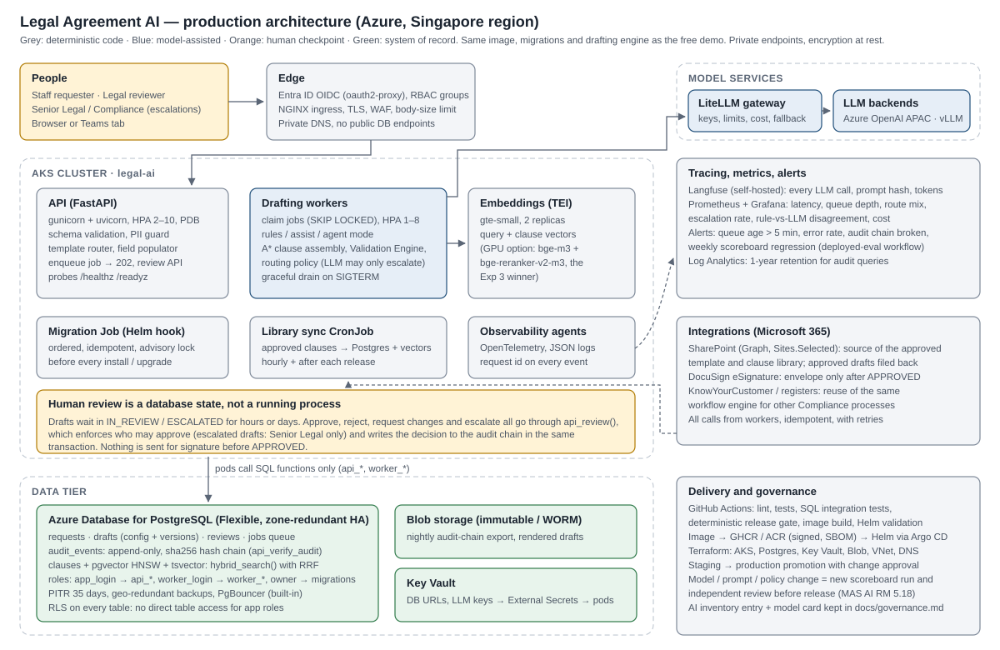
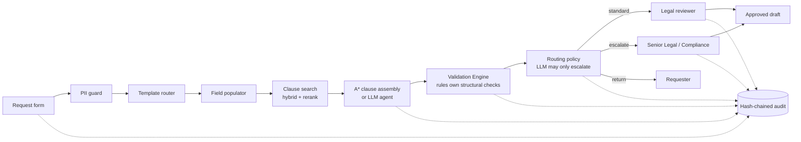
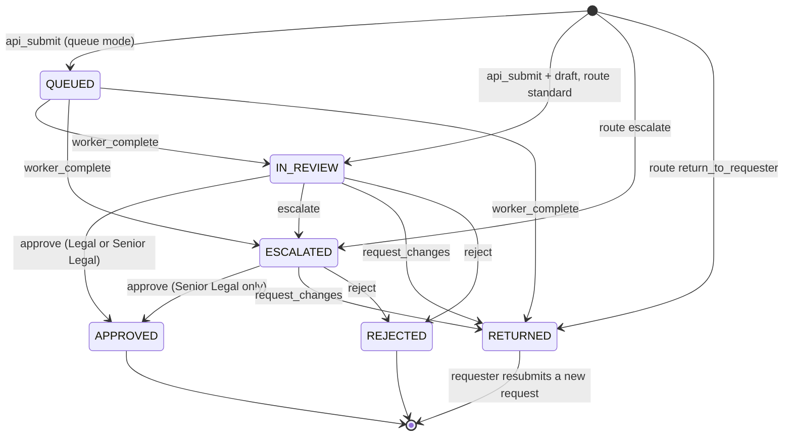

# Architecture

**System:** Legal Agreement AI, an internal drafting assistant for a MAS-regulated fund manager in Singapore.
**Status:** final architecture, 16 October 2026. Supersedes the stack sketch in README Part 1 where they differ; each change is recorded below as a decision record with the evidence behind it.
**Diagram:** [figures/production-architecture.svg](figures/production-architecture.svg).

---

## 1. What the system must do

The requirements come from the ICHAM internship description (the closest thing to a specification) and the MAS Guidelines on AI Risk Management issued on 7 October 2026.

| Requirement | Where it is met |
|---|---|
| Structured request form for agreement requests | `src/app/templates/new_request.html`, `RequestIn` schema in `src/app/main.py` |
| Pick the right approved template | Template router: agreement type → template in `configs/policy.yaml` (deterministic) |
| Populate standard fields | Field populator: form values, rule extraction from text, LLM only in assist/agent mode |
| Central library of approved clauses and terms | `data/synthetic/clauses.jsonl` (versioned), synced to Postgres by `src/app/sync.py` or the Edge Function |
| Validation of missing, inconsistent or incomplete information | Validation Engine `src/agreement/validation.py` |
| Routing for Legal review, approval, escalation | Routing policy + `api_review()` SQL function |
| Track status, approvals, versions | `requests`, `drafts`, `reviews` tables; state machine in SQL |
| Audit trail and management reporting | Hash-chained `audit_events`; dashboard, queue, audit pages; `api_stats()` |
| Approved tools, data protection, AI governance | PII guard, model gateway, no LLM in the default mode, `docs/governance.md` |
| Legal review before execution | Only `api_review()` can set APPROVED; escalated drafts need Senior Legal |
| SharePoint and e-signature integration | Worker-side integrations (designed; not built in the prototype, see section 9) |

## 2. Logical architecture

| Component | Module | Deterministic or model |
|---|---|---|
| Request intake, schema validation | `src/app/main.py` (`RequestIn`) | Deterministic |
| PII guard | `src/app/pii.py` | Deterministic (Presidio in production) |
| Template router, field populator | `src/drafting/harness.py:form_fields`, `src/agreement/fields.py` | Deterministic |
| Clause search | `src/app/search.py`, `src/retrieval/service.py`, `hybrid_search()` SQL | Retrieval models |
| Clause assembly | `src/drafting/assembly.py` (A*), `src/drafting/harness.py` (agent) | Rules + retrieval, optional LLM |
| Validation Engine | `src/agreement/validation.py` | Deterministic |
| Routing policy | `src/agreement/validation.py:route`, `guard_route` | Deterministic |
| Drafting engine (modes) | `src/drafting/engine.py` | Configurable |
| Rendering (.docx) | `src/agreement/render.py` | Deterministic |
| Workflow state machine, audit | `db/migrations/0001_core.sql` (`api_*`, `worker_*`, `audit_append`) | Deterministic |
| Queue worker | `src/app/worker.py` | Deterministic orchestration |

## 3. Workflow state machine

Every transition is one SQL function call in one transaction, and writes its audit event in the same transaction. A draft waiting for review is a row, not a running process, so waits of days cost nothing and survive deployments.

## 4. Deployment topologies

One codebase and one set of migrations run in three places. Only adapters change (`STORE`, `SEARCH`, `PROCESSING`, `DRAFTING_MODE`).

| | A. Free demo (live) | B. Single machine | C. Production |
|---|---|---|---|
| Where | Vercel (Python 3.12, `sin1`) + Supabase (Postgres 17, `ap-southeast-1`) | `deploy/docker-compose.yml` | AKS + Azure Database for PostgreSQL, Singapore |
| App tier | Serverless FastAPI | API container + 2 workers | API Deployment (HPA 2–10) + workers (HPA 1–8) |
| Processing | inline | queue | queue |
| Workflow store | Supabase via PostgREST RPC (`api_*`) | Postgres (`app_login`) | Managed Postgres (`app_login`, `worker_login`) |
| Search | Edge Function: gte-small + `hybrid_search()` | TEI gte-small + `hybrid_search()` | TEI gte-small, or the GPU profile (Exp 3 winner) |
| LLM | none (rules mode) | optional: host Ollama | LiteLLM → Azure OpenAI Data Zone APAC or vLLM |
| Secrets | none: publishable keys only | `deploy/.env` (local) | Key Vault → External Secrets |
| Delivery | GitHub → Vercel Git integration; CI gates | `docker compose up` | GitHub Actions → registry → Helm (Argo CD) |
| URL | https://legal-agreement-ai.vercel.app | http://localhost:8000 | internal, behind Entra ID |

## 5. Architecture decision records

### ADR-1 The database is the workflow engine
**Decision:** the request state machine, review permissions and audit trail live in Postgres functions (`api_submit`, `api_review`, `worker_claim`, `worker_complete`, `audit_append`). The app tier is stateless.
**Why:** human review takes hours or days. Holding that wait in an agent server (the README Part 1 plan: LangGraph Agent Server, optionally under Temporal) needs a long-lived process, Redis and a licence key, and it cannot run on serverless (LangGraph docs). A row in `IN_REVIEW` costs nothing, survives redeploys, and puts the state change and its audit event in one transaction. LangGraph is still used where it fits: inside the H4 agent harness, whose human-review `interrupt()` is exercised in Experiment 2.
**Consequences:** the same migrations serve Supabase and Kubernetes; integration tests run the real SQL in CI; business rules that guard state (who may approve what) cannot be bypassed by any client.

### ADR-2 Deterministic first; the LLM is optional and can only add caution
**Decision:** three drafting modes. `rules` (no LLM) is the default; `assist` (LLM extracts the requests) and `agent` (tool-using agent with a validation loop) are enabled by configuration. In every mode the Validation Engine owns structural checks, and the routing policy decides the route; an LLM may escalate further but never downgrade (`guard_route`).
**Why:** see Experiment 2 (section 6). Rules catch every planted structural defect with no false alarms; LLM-raised structural issues were mostly false alarms; the LLM's value is in semantic checks and phrasing.
**Consequences:** the system works with no model at all (free demo, outage fallback); model risk is confined to clause matching and notes, which a human reviews.

### ADR-3 pgvector inside the system-of-record database
**Decision:** clause vectors and full-text index live in the same Postgres (`hybrid_search()`, RRF), not in a separate vector database.
**Why:** the approved library is small (129 clauses here, low thousands in practice). One database means one backup, one access-control model, and transactional consistency between the library version and the drafts that cite it. Qdrant remains an option if the library grows by orders of magnitude.

### ADR-4 Two retrieval profiles, both measured
**Decision:** production uses the Experiment 3 winner when a GPU host is available (BGE-M3 hybrid + bge-reranker-v2-m3 + contextual chunks, `src/retrieval/service.py`). The free tier uses gte-small in a Supabase Edge Function with Postgres hybrid search.
**Why:** the free tier has no GPU. Its quality is measured on the same frozen test split (`eval/results/deployed/`) instead of being assumed, so the gap is explicit (section 6).

### ADR-5 Tamper-evident audit
**Decision:** `audit_events` is append-only (trigger rejects UPDATE/DELETE) and hash-chained; `api_verify_audit()` recomputes the chain; production exports it nightly to immutable blob storage. Every draft event records the policy hash, library hash, code version, mode, search backend and (for LLM modes) model and prompt hash.
**Why:** MAS AI RM Guidelines 5.9(d) (logs of oversight decisions) and 5.17 (reproducibility and auditability).

### ADR-6 No secrets in the demo; least privilege in production
**Decision:** the demo app holds only Supabase publishable keys, which grant nothing but EXECUTE on `api_*` (RLS closes every table). The Edge Function uses its platform-provided service role for the library sync only, from a fixed source URL. Production uses separate login roles (`app_login`, `worker_login`, migration owner) with credentials from Key Vault.

### ADR-7 Postgres as the job queue
**Decision:** queue mode uses a `jobs` table with `SELECT ... FOR UPDATE SKIP LOCKED`, retries (3), and lock expiry (5 minutes), instead of Redis or Temporal.
**Why:** drafting jobs are short (milliseconds in rules mode, about a minute in agent mode with a local 7B model) and low volume. Temporal remains the right tool if long, exactly-once external side effects (e-signature, SharePoint filing) are added.

### ADR-8 Model access through a gateway, pinned to the region
**Decision:** LLM calls go through an OpenAI-compatible gateway (LiteLLM) to Azure OpenAI Data Zone Standard (APAC) or a self-hosted vLLM. Chat models are not available for Singapore-only regional processing on Azure (README 1.7), so in-country inference means self-hosting.

## 6. Evidence behind the decisions

All on the same frozen test split (90 synthetic requests), 3 seeds for LLM conditions. Full write-ups: [experiment2-results.md](experiment2-results.md), [experiment3-results.md](experiment3-results.md), [`eval/results/deployed`](../eval/results/deployed/summary.md).

| Decision | Evidence |
|---|---|
| ADR-2 rules-first drafting; LLM optional, may only escalate | Experiment 2: rules + A* (no LLM) 0.444 task success and 0.889 routing accuracy with zero false alarms, against 0.233 / 0.504 / 97% false alarms for a single LLM call and 0.13–0.24 success for agent harnesses at 8–11× the tokens. The validation loop is the only agent component that clearly helps (routing 0.49 → 0.75). The LLM is needed for semantic checks: asks with no approved clause are caught 93–100% by the LLM and 0% by rules |
| ADR-2 recommended LLM mode `assist` (H3b), not `agent` | H3b: 0.352 success, 0.807 routing, 0.10 false alarms with one LLM call (291 tokens); 12 successes per 10k tokens against 0.03–0.06 for the agents |
| ADR-4 GPU retrieval profile = Experiment 3 winner | R5 (BGE-M3 hybrid + reranker + contextual chunks) leads on our clause library (nDCG@10 0.536) and LegalBench-RAG-mini; retrieval cuts the hallucinated-clause rate from 0.995 to under 0.01 |
| ADR-4 free tier measured, not assumed | gte-small hybrid in Supabase, rules mode: 0.356 success, 0.867 routing, 0.587 ask recall, against 0.444 / 0.889 / 0.687 with the GPU profile. The gap is retrieval quality only (same rules, same policy) |
| ADR-5 / 5.9 human oversight works as designed | Live demo and CI integration tests: escalated drafts cannot be approved by a Legal reviewer (SQL-enforced), the audit chain verifies intact, updates and deletes on `audit_events` are rejected; the H4 human-review interrupt paused and resumed in 270/270 runs |
| Capacity of the free tier | Load test: about 24 requests/s at concurrency 10, draft preview p50 0.47 s, p95 under 2.4 s, no server errors |

## 7. Security

| Threat | Control |
|---|---|
| Prompt injection in the request text | Text is data: rule detector + LLM checker; any detection escalates; LLM cannot lower a route; validators run independently of the LLM |
| Hallucinated clauses or terms | Only library `clause_id`s render; invented ids are dropped and logged; human approval required |
| Personal data leakage | PII guard before storage or any LLM call; synthetic data in the demo; region-pinned services |
| Unauthorised approval | `api_review()` checks role and state in SQL; escalated drafts need Senior Legal; production identities from Entra ID |
| Tampering with history | Append-only, hash-chained audit; WORM export |
| Web attacks | CSP `default-src 'self'` (no inline script/style), frame denial, origin check on POST, rate limiting (app and database), Pydantic size limits |
| Direct database access | RLS on every table; app roles have EXECUTE on functions only |
| Supply chain | Pinned base images, lean runtime deps, CI on every change, image smoke test; production adds signing and SBOM |

## 8. Operations

- **SLOs (production proposal):** API availability 99.5% in business hours; p95 time-to-draft under 5 s in rules mode and under 90 s in agent mode; zero lost requests (queue retries + DB transactions).
- **Backups and recovery:** managed Postgres PITR (35 days), zone-redundant HA; RPO 5 minutes, RTO 1 hour. Audit chain exported nightly to immutable storage.
- **Releases:** CI must pass (tests, release gate, SQL integration tests, image and chart checks); staging soak; a model, prompt, policy or library change triggers a scoreboard run and independent review before promotion (MAS 5.18).
- **Runbook:** `docs/runbook.md`.

## 9. Not built in the prototype

SharePoint and DocuSign integrations, Entra ID sign-in (the demo uses role switches), Langfuse/Prometheus wiring, Terraform for Azure, and the GPU retrieval service as a separate deployment. Each has a defined place in the design above; none is needed to demonstrate the workflow end to end.
