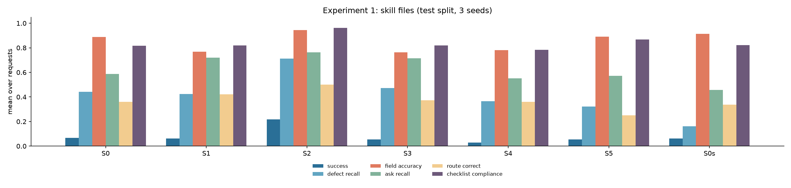

# Experiment 1 results: does a SKILL.md playbook beat a vanilla LLM? (RQ1)

**Answer: yes, but only the focused skill, where the model loads the files it needs.** On the 90 frozen test requests (3 seeds), S2 succeeds on 0.219 of requests against 0.067 for the vanilla prompt (McNemar 18 / 4, p = 0.004; Holm over the four 7B skill conditions, 0.017). The same skill content given all at once, as a long system prompt (S1) or as one comprehensive skill (S3), does no better than vanilla. A skill the model wrote for itself (S4) does not help. On the 3B model the focused skill does not raise success (S5).

All of these are the drafts' automatic scores. An LLM judge of the reviewer notes finds no improvement from any skill (see below).

Method and conditions: [experiment12-method.md](experiment12-method.md). Full tables with CIs: [`eval/results/exp1/summary.md`](../eval/results/exp1/summary.md). Model qwen2.5:7b via Ollama 0.40.13 (S5, S0s: qwen2.5:3b), temperature 0.3, seeds 1–3, retrieval = the Experiment 3 winner (R5), the top 8 candidate clauses per request. Run on 1 November 2026: 1,890 runs, about 3 hours on one RTX 4060 laptop GPU with 4 parallel decoding slots.

## Headline table

| Condition | Success | pass^3 | Route correct | Defect recall | Field accuracy | Ask recall | Citation accuracy | Checklist compliance | LLM calls | Tokens | Seconds |
|---|---|---|---|---|---|---|---|---|---|---|---|
| S0 vanilla | 0.067 | 0.056 | 0.359 | 0.443 | 0.887 | 0.587 | 0.589 | 0.817 | 1 | 1,201 | 12.8 |
| S1 skill content as a long system prompt | 0.063 | 0.022 | 0.422 | 0.423 | 0.768 | 0.720 | 0.575 | 0.820 | 1 | 4,654 | 38.3 |
| **S2 focused skill (loads ≤ 3 files)** | **0.219** | **0.122** | **0.500** | **0.711** | **0.945** | **0.764** | **0.751** | **0.962** | 2 | 6,037 | 27.1 |
| S3 comprehensive skill | 0.056 | 0.022 | 0.374 | 0.472 | 0.763 | 0.716 | 0.587 | 0.819 | 1 | 4,424 | 35.3 |
| S4 skill written by the model | 0.030 | 0.000 | 0.359 | 0.366 | 0.780 | 0.551 | 0.404 | 0.784 | 1 | 1,965 | 18.8 |
| S5 S2 on qwen2.5:3b | 0.056 | 0.000 | 0.252 | 0.321 | 0.892 | 0.573 | 0.646 | 0.868 | 2 | 5,920 | 15.3 |
| S0s S0 on qwen2.5:3b | 0.063 | 0.056 | 0.337 | 0.163 | 0.913 | 0.458 | 0.538 | 0.821 | 1 | 1,174 | 6.8 |

Success = route correct, every planted defect caught, every supported ask cited with an acceptable clause, no invented clause, all fields correct. pass^3 = success in all three seeds. The model's output is scored as it is: no rules engine runs in Experiment 1.

## Paired tests

Against the vanilla prompt (S0), from `summary.md`:

| Condition | Δ success | Δ defect recall | Δ field accuracy | Δ ask recall | Δ route correct | McNemar (only condition / only S0), p |
|---|---|---|---|---|---|---|
| S1 | −0.004 | −0.020 | **−0.119*** | **+0.134*** | +0.063 | 5 / 5, p = 1 |
| S2 | **+0.152*** | **+0.268*** | **+0.058*** | **+0.177*** | +0.141 | 18 / 4, p = 0.004 |
| S3 | −0.011 | +0.028 | **−0.124*** | **+0.129*** | +0.015 | 3 / 4, p = 1 |
| S4 | **−0.037*** | −0.077 | **−0.107*** | −0.036 | +0.000 | 1 / 2, p = 1 |

Other pairs (same tests, computed from the run cache):

| Pair | Δ success | McNemar, p | Also |
|---|---|---|---|
| S2 − S1 | **+0.156*** [+0.07, +0.24] | 19 / 5, p = 0.007 | field accuracy +0.177*, citation accuracy +0.186*, defect recall +0.289* |
| S2 − S3 | **+0.163*** [+0.08, +0.25] | 19 / 4, p = 0.003 | field accuracy +0.182*, citation accuracy +0.181*, defect recall +0.240* |
| S2 − S4 | **+0.189*** [+0.11, +0.27] | 18 / 3, p = 0.001 | citation accuracy +0.358* |
| S5 − S0s (3B) | −0.007 [−0.06, +0.04] | 3 / 4, p = 1 | ask recall +0.114*, citation accuracy +0.125*, route correct −0.085 |

\* 95% paired bootstrap CI excludes zero. Brackets: the CI.

## Findings

1. **The focused skill is the only variant that helps.** S2 more than triples success (0.067 → 0.219). It catches more planted defects (0.44 → 0.71), fills fields more accurately (0.887 → 0.945), cites requested clauses more often and more accurately (ask recall 0.59 → 0.76, citation accuracy 0.59 → 0.75) and passes more of the eight checklist checks (0.82 → 0.96). It escalates 10 of the 15 prompt-injection runs, S0 none (only 5 requests, so not tested). Its gain is on requests with a planted defect (success 0.016 → 0.228 on 41 requests), where S0 almost never succeeds. On the 49 clean requests the gain is smaller (0.109 → 0.211).
2. **Focus, not content.** S1 and S3 give the model `SKILL.md` and all seven of its files at once; S2 gives it `SKILL.md` and the three files it chooses. All at once changes nothing on success and costs about 0.12 field accuracy (significant). Loaded file by file, the skill wins against both (p = 0.007 and 0.003). In S2 the model loaded the checklist for the request's agreement type in all 270 runs, always together with the two reference files (fallback positions and the glossary). One confound remains: S2 also makes one extra call, in which the model reads the skill index and picks files before drafting.
3. **A skill the model writes for itself does not help.** S4 is the lowest 7B condition (−0.037; the bootstrap CI excludes zero, but McNemar is 1 / 2, p = 1) and cites clauses least accurately (0.40).
4. **On the 3B model the focused skill does not raise success.** S5 cites better than S0s (ask recall +0.11, citation accuracy +0.13, both significant). It also flags a defect on more clean requests (+0.20, significant), and its routing is lower (−0.085, not significant). 9 of its 270 drafts were not valid JSON.
5. **The playbook is consistent across experiments.** Experiment 2's H0 is also a single call with skill content: the code loads the agreement type's checklist and the fallback positions, without the glossary S2 loaded. It scored 0.233 on the same requests (Ollama 0.40.5), close to S2's 0.219. The rules-first designs of Experiment 2 still do better: H-det 0.444 and H3b 0.352.

## Caveats on S2's gain

- **It needs the field condition.** Without it (`success_core`: route, defects, asks, no invented clause), S2 − S0 is +0.111 [−0.00, +0.22], McNemar 21 / 13, p = 0.23: not significant. The significant result depends on S2 also getting every field right more often.
- **It escalates far more.** Route accuracy by gold route, over all runs:

  | Gold route (runs) | S0 | S2 |
  |---|---|---|
  | escalate (138) | 0.05 | 0.76 |
  | return to requester (42) | 0.00 | 0.43 |
  | standard review (90) | 1.00 | 0.13 |

  S0 sends almost everything to standard review; S2 escalates most requests, including 50 of 90 standard-review runs. Escalation precision falls from 1.00 to 0.59 while recall rises from 0.05 to 0.76. The route-correct gain (+0.14) is not significant: S2 trades one error for the other. In a review workflow over-escalation is the safer error, but it costs reviewer time.
- **More false alarms.** S2 reports a defect on 0.98 of clean requests against 0.80 for S0 (+0.18, significant). Every free-form LLM condition over-flags, as in Experiment 2; the production design lets the rules own structural checks.
- **Cost.** S2 uses 5× the tokens of S0 (6,037 against 1,201) and 2 calls, and takes about twice as long (27 s against 13 s). Per 10,000 tokens, S0 yields more successes (0.55 against 0.36); per request, S2 yields 3.3× as many.
- **Hallucinated fields** are defined on only the 20 requests with an unknowable field. S2's rate (0.25) is above S0's (0.18), but the CIs are wide and overlap.
- **Absolute success is low.** The best condition succeeds on 22% of requests. 78% of S2's runs still fail at least one condition: most often the route (50% of runs), then a requested clause not cited (36%) and a field (36%).

## LLM judge of reviewer notes

`eval/judge.py`: llama3.1:8b, a different model family from the drafter, grades each condition's reviewer note on five yes/no questions: agreement type and counterparty, every special request, every reference problem, the route, and no invented facts. It covers 18 test requests sampled with a fixed seed (20%), using the seed-1 runs, with condition names hidden. Full table, including the Experiment 2 harnesses: [`eval/results/judge/summary.md`](../eval/results/judge/summary.md).

| Condition | Judge score (share of 5 questions true) | No invented facts | Mean words |
|---|---|---|---|
| S0 | 0.37 [0.28, 0.44] | 0.72 | 10 |
| S1 | 0.41 [0.30, 0.52] | 0.44 | 14 |
| S2 | 0.34 [0.24, 0.43] | 0.28 | 25 |
| S3 | 0.30 [0.19, 0.42] | 0.28 | 12 |
| S4 | 0.37 [0.27, 0.47] | 0.50 | 10 |
| S5 | 0.27 [0.19, 0.33] | 0.28 | 16 |
| S0s | 0.30 [0.19, 0.41] | 0.39 | 11 |

- **The skill does not make the notes better.** S2 − S0: −0.022 [−0.12, +0.08] (6 requests better, 7 worse). No skill condition differs significantly from its baseline.
- **S2's notes were judged to invent facts more often.** On 9 requests S2's note failed "no invented facts" where S0's passed, against 1 the other way (exact McNemar p = 0.02, one of many judge comparisons and not corrected). Its notes are 2.5× longer and report more problems, including the false alarms above.
- **All notes score low.** The best condition gets 0.47 (H3b); almost no note lists every special request (0.00–0.11).
- **Experiment 2, same pass:** H3b scored highest (0.47 [0.36, 0.58]), but no harness differs significantly from H0 (H3b − H0: +0.056 [−0.12, +0.22]). H4's notes are identical to H3's on all 18 requests, and H2's on 16.
- **How far to trust it:**
  - 2 of the 252 judge replies could not be parsed and count as all-false.
  - Length bias is modest (Spearman ρ between −0.33 and +0.35 per condition).
  - The human spot-check that would calibrate the judge (`human_spotcheck.csv`, Cohen's κ) has not been done: it needs a person.

## Comparison with the tax domain

The same playbook design was moved to the teammate's Singapore income-tax RAG ([taxrag-rq12-results.md](taxrag-rq12-results.md)). There the focused skill chosen on dev scored −0.025 against his prompt (qwen3:8b, 79 test questions, not significant), and in an exploratory count (not pre-registered) the variants that load the whole skill answered more questions wrongly (14 against 5). A likely reason: in drafting, the skill supplies checklists, approved ranges and routing rules the model would otherwise lack, while a tax answer has to come from reading the statute. The two tests also differ in model (qwen2.5:7b against qwen3:8b), skill and metric, so this explanation is untested.

## Deviations and disclosures

- **S2 module matching was fixed before the test run.** In the dev pilot an empty module name matched every file, and the 3-file cap followed index order instead of the model's order. The fix (`src/drafting/harness.py`) was recorded in [taxrag-rq12-protocol.md](taxrag-rq12-protocol.md#rq1-on-legal-agreements-the-deferred-experiment-1-run) before the run started.
- **Server.** Ollama 0.40.13 with the Experiment 2 layout (4 slots of 8,192 tokens, flash attention, q8_0 KV cache). Experiment 2 ran on Ollama 0.40.5 on 16–17 October 2026.
- **The test split, skill files and metrics are unchanged** since they were committed (the test split in `e42a434`; the release-gate test checks its hash).

## Limitations

- One synthetic test set written by the same author as the skill (circularity control: the test set was committed before the skill was written; see the method).
- One 7B model family. A stronger model may need the playbook less, or use the comprehensive version better.
- The LLM judge is a second small model on a 20% sample, and its human spot-check has not been done.

The Experiment 3 addendum that ran with this experiment (drafting from A\*-graph evidence) is reported in [experiment3-results.md](experiment3-results.md#addendum-drafting-from-a-graph-evidence-r6d-1-november-2026).
