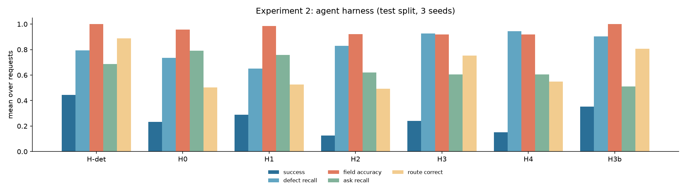
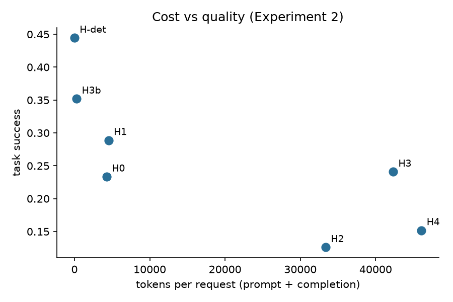

# Experiment 2 results: does an agent harness beat a single LLM call? (RQ2)

**Answer: no, not with a local 7B model.** On the 90 frozen test requests (3 seeds), the rules-only pipeline beats every LLM harness on task success and routing, and the plain tool-using agent is the worst condition. Among LLM harnesses, the one that wins is the one that uses the LLM least: one call to extract the special requests, then A* clause assembly and the rules (H3b). Inside the agent family, the validation/reflection loop is the component that matters; adding more agents on top of it makes results worse.

Method and conditions: [experiment12-method.md](experiment12-method.md). Full tables with CIs: [`eval/results/exp2/summary.md`](../eval/results/exp2/summary.md). Model qwen2.5:7b via Ollama, temperature 0.3, seeds 1–3, retrieval = the Experiment 3 winner (R5).

## Headline table

| Condition | Success | pass^3 | Route correct | Defect recall | False alarm on clean | Ask recall | LLM calls | Tokens | Seconds |
|---|---|---|---|---|---|---|---|---|---|
| **H-det** rules + A*, no LLM | **0.444** | **0.444** | **0.889** | 0.793 | **0.000** | 0.687 | 0 | 0 | 0.0 |
| H0 single call | 0.233 | 0.122 | 0.504 | 0.736 | 0.973 | **0.792** | 1 | 4,287 | 28.1 |
| H1 fixed pipeline | 0.289 | 0.211 | 0.526 | 0.650 | 1.000 | 0.757 | 2 | 4,530 | 28.9 |
| H2 ReAct agent | 0.126 | 0.022 | 0.493 | 0.829 | 0.537 | 0.621 | 6.9 | 33,365 | 53.2 |
| H3 agent + validation loop | 0.241 | 0.133 | 0.752 | 0.927 | 0.238 | 0.606 | 8.3 | 42,322 | 77.3 |
| H4 H3 + checker + router agents + HITL | 0.152 | 0.067 | 0.548 | **0.943** | 0.347 | 0.606 | 10.3 | 46,081 | 85.9 |
| **H3b** LLM requests + A* + rules | 0.352 | 0.256 | 0.807 | 0.902 | 0.102 | 0.511 | 1 | 291 | 5.3 |

Success = route correct, every planted defect caught, every supported ask cited with an acceptable clause, no invented clause, all fields correct. Seconds are per request on one RTX 4060 laptop GPU with 4 parallel decoding slots.

## Paired tests against the single call (H0)

| Condition | Δ success | Δ route correct | Δ defect recall | Δ ask recall | McNemar (only condition / only H0), p |
|---|---|---|---|---|---|
| H-det | **+0.211*** | **+0.385*** | +0.057 | −0.106* | 31 / 11, p = 0.003 |
| H1 | +0.056 | +0.022 | −0.085 | −0.035 | 13 / 7, p = 0.26 |
| H2 | **−0.107*** | −0.011 | +0.093 | −0.171* | 5 / 14, p = 0.064 |
| H3 | +0.007 | **+0.248*** | **+0.191*** | −0.187* | 13 / 14, p = 1 |
| H4 | −0.081* | +0.044 | **+0.207*** | −0.187* | 8 / 16, p = 0.15 |
| H3b | +0.119* | **+0.304*** | +0.167* | −0.282* | 24 / 13, p = 0.099 |

\* 95% paired bootstrap CI excludes zero.

## Findings

1. **Decomposition into deterministic steps is what helps, not agency.** H-det doubles H0's success (+0.21, McNemar p = 0.003) and raises routing accuracy from 0.50 to 0.89 with no false alarms. Caveat: the rule-based request segmentation and field extraction were written against the synthetic request phrasing (on the dev split), so H-det is optimistic on this data; on real, messier requests it would need the LLM extractor, which is H3b.
2. **The 7B model over-flags.** Free-form LLM issue lists (H0, H1) raise a defect on 97–100% of clean requests: approved fallbacks such as English law are reported as governing-law problems, ordinary fees as out of range. This is why the production design lets the rules own every structural check and lets an LLM only add semantic issues.
3. **The LLM's real contribution is semantic.** Asks that no approved clause covers are caught 93% (H0) and 100% (H1) of the time by the LLM and never by the rules (0%). The LLM also matches requests to clauses better than rule segmentation (ask recall 0.79 vs 0.69).
4. **The validation loop is the agent component worth keeping.** H3 vs H2: success 0.13 → 0.24, route accuracy 0.49 → 0.75, false alarms 0.54 → 0.24, defect recall 0.83 → 0.93. The plain ReAct agent (H2) is the worst condition: 262 of 270 runs hit the 7-step cap and a third of its 1,604 tool calls repeat an earlier call exactly, its fields are least accurate (it invents values for 30% of unknowable fields), and it is the least consistent (pass^3 = 0.02).
5. **More agents made it worse.** H4 adds a compliance-checker agent and a router agent to H3. It catches slightly more defects (0.94) but success drops to 0.15: the router agent escalates too eagerly (escalation precision 0.72 → 0.53), and the guard that lets an LLM escalate but never downgrade turns every over-escalation into a routing error. The LangGraph human-review `interrupt()` paused and resumed correctly in all 270 runs.
6. **Cost.** The agent harnesses use 33–46k tokens and 7–10 LLM calls per request, about 8–11× a single call, for equal or lower success. Successes per 10,000 tokens: H3b 12.1, H1 0.64, H0 0.54, H3 0.06, H2 0.04, H4 0.03.
7. **Consistency (τ-bench pass^3).** Deterministic conditions are perfectly repeatable; among LLM conditions H3b is the most consistent (0.26), H2 the least (0.02).

## Exploratory, post-hoc: rules plus the LLM's semantic flags

Designed after these test results were seen, so it is a hypothesis for the next frozen test set, not a result. No new model calls: H-det's output plus the first `unsupported_clause` flag from an LLM run, route recomputed by the policy ([`eval/results/exp2/posthoc_hybrid.md`](../eval/results/exp2/posthoc_hybrid.md)).

| Variant | Success | Route correct | Defect recall | False alarm on clean | Unsupported asks caught |
|---|---|---|---|---|---|
| H-det | 0.444 | 0.889 | 0.793 | 0.000 | 0.00 |
| H-det + H0 flags | 0.419 | 0.778 | 0.984 | 0.367 | 0.93 |
| H-det + H1 flags | 0.333 | 0.696 | 1.000 | 0.653 | 1.00 |
| H-det + H3b flags | **0.470** | **0.889** | 0.902 | 0.102 | 0.53 |

The free-form LLM flags catch almost every unsupported ask but bring false alarms with them; the flags that come from retrieval abstention (H3b) are precise but catch only half. This is the design question to settle with a stronger model.

## What this changes in the architecture

- **Default drafting mode is `rules`** (H-det), which is also the no-cost mode the free demo runs. **`assist`** (H3b: one LLM call, 291 tokens) is the recommended LLM mode. **`agent`** (H3) is kept in the code but not recommended with a small local model. See ADR-2 in [architecture.md](architecture.md).
- The rules own structural checks; an LLM can add semantic issues and can escalate, never downgrade.
- Before enabling LLM modes in production, re-run this experiment with the production model (e.g. Azure OpenAI via the gateway): a stronger model may close the gap, and the harness, metrics and frozen test set are ready for it.

## Limitations

- One local 7B model; results for hosted frontier models may differ, especially for the agent conditions.
- Synthetic requests and policy written by the same team; the rule components were written against the dev-split phrasing.
- The parallel inference server (4 slots, q8_0 KV cache) makes outputs slightly batch-dependent; every output is cached, so the reported numbers are reproducible from the cache.
- The LLM judge of reviewer notes and the human spot-check were not run.
