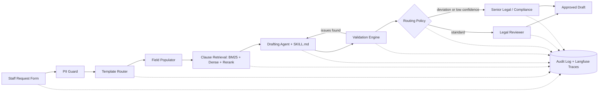

# AI-Assisted Legal Agreement Generation & Workflow Automation

**A controlled comparison of Skill files, Agent harnesses and Retrieval pipelines against a vanilla LLM**

| | |
|---|---|
| **Assignment** | Exploring the Ecosystem of General AI, Generative AI, AI Agents and RAG (Group, 40%) |
| **Submission type** | Option A: Coding-based (working prototype + 3–5 min demo video + GitHub repo) |
| **Domain** | Legal & Compliance operations in a MAS-regulated fund / wealth management company (Singapore) |
| **Team size** | 4–6 students |
| **Status** | Draft project plan |

---

## 1. Summary

We build a prototype that helps internal staff request legal agreements (NDAs, Investment Management Agreements, Distribution Agreements, Side Letters, Subscription Agreements). The system selects the correct approved template, fills in standard fields, retrieves approved clauses, validates the draft for missing or inconsistent information, and routes it to a human Legal reviewer with a full audit trail.

The prototype is also a controlled experiment. We switch three components on and off and measure each against a plain ("vanilla") LLM on the same test set:

1. **Skill file:** does an LLM with a `SKILL.md` drafting playbook beat a plain LLM?
2. **Agent harness:** does a tool-using agent with validation loops and human escalation beat a single LLM call?
3. **Retrieval:** does a better retrieval pipeline (hybrid search, reranking, contextual retrieval) produce more accurate, grounded drafts than no retrieval or naive RAG?

All results are reported on a shared **Scoreboard**. No AI output is executed without human Legal review.

---

## 2. Business Context and Problem

### 2.1 Scenario

In a typical fund management company, sales, operations and investment staff regularly need standard agreements. The in-house Legal team prepares each one manually from Word templates. Requests arrive by email or chat, often with missing details.

### 2.2 Current-state pain points

- Incomplete requests cause repeated back-and-forth between staff and Legal.
- Staff or Legal may pick the wrong or an outdated template.
- Copy-pasting standard fields introduces typos and inconsistencies (e.g., mismatched counterparty names or dates).
- There is no central view of draft status, approvals or versions.
- Experienced lawyers spend time on routine drafting instead of high-value review.

### 2.3 Evidence that the problem is real

**Demand signal from industry.** A public internship job description (October 2026) from a MAS-regulated fund management company in Singapore describes this exact project. It covers mapping the request process, a structured request workflow, template-selection logic, auto-population of standard fields, a central library of approved clauses, validation rules, routing for Legal review and escalation, status tracking, and audit trails. It also requires approved tools, AI governance compliance, and Legal review before execution.

**Industry data** (vendor surveys, so treat with caution):

| Finding | Source |
|---|---|
| 49% of 115 surveyed in-house legal teams still manage contracts with email, Word documents and shared folders | SpotDraft Contract Efficiency Benchmarking Survey, 2025 |
| Automation could cut contract processing time from about 19 days to about 3 days | SpotDraft, 2025 |
| In-house legal professionals spend an average of 3.1 hours reviewing a single contract | LegalOn & In-House Connect, State of AI for In-House Legal, 2026 (452 respondents) |
| 79% of respondents using AI report less time on routine legal tasks | LegalOn & In-House Connect, 2026 |

**Risk evidence.** A preregistered Stanford study found that leading commercial AI legal research tools hallucinated in roughly 17–33% of queries, even with retrieval (Magesh et al., 2025). Human review is therefore a design requirement, not a disclaimer.

**Regulatory context.** The Monetary Authority of Singapore (MAS) has proposed Guidelines on AI Risk Management for financial institutions, covering board oversight, AI inventories, risk materiality assessment and life-cycle controls. Singapore's PDPA also applies to personal data in agreements.

---

## 3. Objectives and Research Questions

**Business objective:** reduce the time and error rate of routine agreement drafting while keeping Legal in control.

| ID | Research question | Hypothesis |
|---|---|---|
| RQ1 | Does a `SKILL.md` playbook improve drafting quality over a vanilla LLM? | A focused skill file improves field accuracy and checklist compliance. A long, comprehensive skill helps less. A skill written by the LLM itself does not help. |
| RQ2 | Does an agent harness outperform a single LLM call? | Tools plus a validation/reflection loop catch more planted defects and escalate more accurately, at higher cost and latency. |
| RQ3 | Does a stronger retrieval pipeline improve accuracy and grounding? | Clause-level chunking + hybrid BM25/dense search + reranking improves retrieval recall and reduces hallucinated clauses versus no retrieval and naive RAG. |

Hypotheses are written down before experiments run. Results where the treatment does not win are reported too.

---

## 4. System Architecture

### 4.1 Data flow



**Diagram convention for slides:** grey boxes are deterministic code, blue boxes use an LLM, orange boxes are human checkpoints. A separate "Experiment Switchboard" box points to the three switchable components (Skill, Harness mode, Retrieval mode).

### 4.2 Components

| # | Component | What it does | Deterministic or LLM |
|---|---|---|---|
| 1 | **Request Intake** | Streamlit form; validates input with a Pydantic schema (agreement type, counterparty, dates, governing law, fees) | Deterministic |
| 2 | **PII Guard** | Masks names and account numbers (Presidio or regex) before any external LLM call; logs what was masked | Deterministic |
| 3 | **Template Router** | Maps agreement type + counterparty type to an approved template; LLM fallback only for ambiguous requests, which are flagged for human confirmation | Rules first, LLM fallback |
| 4 | **Field Populator** | Fills standard fields into Jinja2 / `docxtpl` templates | Deterministic (LLM only for free-text fields) |
| 5 | **Clause Retrieval (RAG)** | Searches the approved clause library; returns clauses with `clause_id` and version | Retrieval + reranker |
| 6 | **Drafting Agent** | Assembles the draft; every non-template clause must cite a `clause_id` | LLM |
| 7 | **Validation Engine** | Rule checks (missing fields, date consistency, fee within approved range, governing law, counterparty name consistency) plus an LLM grounding check; outputs an issue list with severity | Rules + LLM |
| 8 | **Routing & Escalation** | Standard drafts go to Legal review; deviations or low confidence escalate to Senior Legal / Compliance. Human approval is always required (LangGraph `interrupt`) | Policy rules |
| 9 | **Audit Trail** | Langfuse traces for every LLM/tool call, plus an append-only `audit_events` table (who, what, when, template version, clause versions, model version, prompt hash, reviewer decision) | Deterministic |
| 10 | **Scoreboard** | Runs every experimental condition on the same test set and shows a leaderboard | Evaluation harness |

**Design principle:** anything that can be done with deterministic code (template choice, field filling, date and fee checks) is done with code. The LLM handles free text, clause selection and issue explanations. This reduces hallucination and supports the governance story.

---

## 5. Experiment Design

### 5.1 Shared rules for all experiments

- Same model, temperature, test set and token budget across conditions within an experiment.
- Every condition runs at least 3 times (different seeds) to report mean, confidence intervals and consistency.
- All conditions use the same codebase, switched by config files (`configs/experiments/*.yaml`).
- The person who writes the test set is not the person who writes the skill file. The test set is frozen before tuning starts.

### 5.2 Experiment 1: Skill file vs vanilla LLM

Skill structure (following the Anthropic Agent Skills format):

```
skills/legal-agreement-drafting/
  SKILL.md                  # YAML frontmatter (name, description) + drafting steps,
                            # pre-submission checklist, "never invent clauses" rule
  checklists/nda.md, ima.md, side_letter.md
  reference/key_terms_glossary.md, fallback_positions.md
  scripts/validate_fields.py
```

| ID | Condition | Purpose |
|---|---|---|
| S0 | Vanilla prompt ("Draft this agreement from the request") | Baseline |
| S1 | Vanilla + long system prompt containing the same content as the skill | Separates the effect of *content* from the *skill mechanism* |
| S2 | Focused `SKILL.md` (≤ 3 modules) | Main treatment |
| S3 | Comprehensive `SKILL.md` (all checklists and full glossary) | Tests "focused beats comprehensive" |
| S4 | Skill written by the LLM itself | Tests "self-generated skills do not help" |
| S5 | S2 on a small open model (via Ollama) | Tests whether small model + skill approaches a large model |

**Metrics:** field-level accuracy / F1 against gold JSON, required-clause coverage, checklist compliance rate, format validity (renders as .docx, no leftover placeholders), LLM-judge rubric score, token cost, latency.

**Basis:** SkillsBench (arXiv, 2026) reported that curated skills raised agent pass rates by an average of 16.2 percentage points, while self-generated skills gave no average benefit, and focused skills outperformed long comprehensive ones. This is not yet peer-reviewed, so we treat it as a hypothesis to test.

### 5.3 Experiment 2: Agent harness vs single LLM call

| ID | Condition | Related work |
|---|---|---|
| H0 | Single call: request → full draft | Baseline |
| H1 | Fixed pipeline (router → populate → draft), no loop | Isolates the effect of task decomposition |
| H2 | ReAct agent with tools: `get_template`, `search_clauses`, `validate_fields`, `check_dates` | ReAct (ICLR 2023), Toolformer (NeurIPS 2023) |
| H3 | H2 + validation / reflection loop (max 2–3 rounds) | Reflexion (NeurIPS 2023), Self-Refine (NeurIPS 2023) |
| H4 | H3 + multi-agent (Drafter, Compliance Checker, Router) + human-in-the-loop interrupt | LangGraph supervisor pattern |

**Metrics:** task success rate (passes all rule checks with all gold clauses present), defect detection recall (share of planted defects caught), false-alarm rate, escalation precision and recall, **pass^k** (k = 3–5, from τ-bench, ICLR 2025) for consistency, number of tool calls, human edit distance, cost, latency.

**Fairness control:** all conditions get the same iteration and token budget, and results are also reported as cost-adjusted performance so H4 does not win just by using more compute.

### 5.4 Experiment 3: Retrieval pipeline vs no RAG vs naive RAG

| ID | Condition |
|---|---|
| R0 | No retrieval (model's internal knowledge only) |
| R1 | Naive RAG: fixed 512-token chunks, dense search, top-5 |
| R2 | Clause-level chunking (split by clause heading) + dense search |
| R3 | R2 + BM25 hybrid search (Reciprocal Rank Fusion) |
| R4 | R3 + cross-encoder reranker |
| R4e | R4 with the embedder swapped: BGE-M3 vs Qwen3-Embedding-0.6B vs one commercial legal embedder (optionally BGE-M3 fine-tuned on our clause library, checked on a held-out split) |
| R4q | R4 + an LLM query rewrite that states the clause's legal purpose before retrieval (principle-augmented query) |
| R5 | R4 + contextual retrieval (an LLM adds 1–2 sentences of context to each chunk before indexing) |
| R6 | *(Stretch goal)* Graph over template → clause → key term |

R4e and R4q come from the research README (sections 2.4.4 and 2.7). R4e exists because BGE-M3 scores 69.44 NDCG@10 on the Massive Legal Embedding Benchmark (MLEB), 18th of 21 models, while the smaller open Qwen3-Embedding-0.6B scores 77.13. R4q exists because adding the legal principle to the query roughly triples MRR on SG-LegalCite (Singapore case law) when the gold principle is used. The gain is much smaller when an LLM has to predict the principle, so report R4q honestly against R4.

**Metrics:**
- Retrieval: Recall@k, MRR, nDCG@10 (using ACORD's graded labels), character-level precision/recall (LegalBench-RAG)
- Generation: faithfulness / groundedness (RAGAS), answer correctness against gold
- **Grounding (primary, scored separately from answer quality):**
  - **citation accuracy**: the cited `clause_id` exists *and* its text supports the generated clause;
  - **hallucinated-clause rate**: clauses not in the library;
  - **claim-support rate**: the share of generated claims supported by the retrieved clauses, following CanLegalRAGBench, which found 8–29% of claims unsupported.

  A single answer-quality score is not enough. On the ObliQA regulatory benchmark, a closed-book model that cited nothing scored within 0.011 of the full RAG pipeline on the RePASs answer metric.
- Efficiency: latency, indexing cost

**Basis:** Anthropic's Contextual Retrieval write-up reported top-20 retrieval failures falling from 5.7% to 1.9% (about 67% fewer) when combining contextual embeddings, contextual BM25 and reranking. That result was on non-legal data, so we test whether it holds for contracts.

---

## 6. Datasets and Benchmarks

### 6.1 Primary test set (built by the team)

**Synthetic agreement requests (~100–150 items)** built from 5–6 synthetic templates. About 30–40% contain planted defects with known answers:

- missing required field
- conflicting dates
- fee outside the approved range
- wrong governing law
- counterparty name mismatch
- request for a clause that does not exist in the library

Two team members label the gold outputs independently, and we report their agreement.

### 6.2 Public legal benchmarks (secondary)

| Benchmark | Venue | Content | Used for |
|---|---|---|---|
| **ACORD** | ACL 2025 | 114 clause-retrieval queries with expert 1–5 star relevance ratings over 126,000+ query–clause pairs | Exp 3 (nDCG, clause retrieval for drafting) |
| **LegalBench-RAG** | arXiv 2024 | 6,858 query–answer pairs over NDAs, M&A agreements, commercial contracts and privacy policies; span-level labels | Exp 3 (use the "mini" subset) |
| **CUAD** | NeurIPS 2021 (Datasets & Benchmarks) | 510 contracts, 41 clause categories, 13,000+ expert annotations | Clause library source + retrieval queries |
| **ContractNLI** | Findings of EMNLP 2021 | 607 NDAs; does the contract entail, contradict or not mention a hypothesis? | Validator evaluation |
| **LegalBench** | NeurIPS 2023 (Datasets & Benchmarks) | 162 legal reasoning tasks | Small contract-related subset for Exp 1 |
| **MAUD** | EMNLP 2023 | Merger agreement reading comprehension (152 agreements) | Optional secondary benchmark |

**Limitation:** all public benchmarks are English-language contracts under US practice (mostly from SEC EDGAR). None cover Singapore fund management agreements, so the synthetic set is the main measure of our use case.

---

## 7. Scoreboard (Evaluation Framework)

**Storage:** one long-format table per run

```
run_id, condition, model, item_id, seed, metric, value, cost_usd, latency_s, trace_url
```

**Metric hierarchy:**

1. **Deterministic metrics first:** exact match on fields, rule checks, valid `clause_id` citations, retrieval metrics.
2. **LLM-as-judge** only for language quality and completeness, using binary checklist rubrics.
3. **Human spot-check** on 15–20% of items to measure judge–human agreement (Cohen's κ).

**Reducing judge bias** (Zheng et al., NeurIPS 2023; Wang et al., ACL 2024):

- Use a judge from a different model family than the generator (reduces self-preference).
- In pairwise comparisons, swap answer order and average (reduces position bias).
- Ask the judge to give reasons before the score.
- Hide condition names from the judge.
- Control for answer length (reduces verbosity bias).

**Statistics:** paired tests on the same items (McNemar for pass/fail, Wilcoxon signed-rank for rubric scores) and bootstrap confidence intervals.

**UI:** a Streamlit "Scoreboard" page showing one chart per experiment plus a cost vs quality view.

---

## 8. Tech Stack

| Layer | Choice | Alternative |
|---|---|---|
| Language | Python 3.11+ | — |
| LLM | One API model (mid-tier) + one small open model via Ollama | — |
| Orchestration | LangGraph (state machine, `interrupt` for human review, checkpoints) | CrewAI |
| Retrieval | `rank_bm25` or Qdrant sparse vectors + sentence-transformers embeddings (e.g., BGE / E5) + `bge-reranker` | LlamaIndex, Haystack |
| Vector store | Qdrant (supports hybrid search) | Chroma (simplest), FAISS |
| Templates | Jinja2 + `docxtpl` → .docx | docassemble (inspiration) |
| Evaluation | RAGAS + DeepEval (pick two of RAGAS / DeepEval / promptfoo) | promptfoo (also for prompt-injection red-teaming) |
| Observability & audit | Langfuse (self-hosted with Docker) + SQLite/Postgres `audit_events` table | — |
| UI | Streamlit (request form, reviewer queue, scoreboard) | — |

### Reference repositories (approximate GitHub stars, check before submission)

| Repo | ≈ Stars | Role in project |
|---|---|---|
| `anthropics/skills` | 180k | SKILL.md format and examples |
| `langchain-ai/langchain` | 145k | Loaders, retriever integrations |
| `langchain-ai/langgraph` | 40k | Agent orchestration, human-in-the-loop |
| `run-llama/llama_index` | 52k | Alternative RAG framework |
| `facebookresearch/faiss` | 41k | Dense index |
| `stanfordnlp/dspy` | 39k | Prompt/skill optimisation (stretch) |
| `langfuse/langfuse` | 35k | Tracing, audit trail, eval datasets |
| `qdrant/qdrant` | 35k | Hybrid vector search |
| `microsoft/graphrag` | 35k | Optional graph retrieval |
| `chroma-core/chroma` | 29k | Lightweight vector store |
| `promptfoo/promptfoo` | 26k | Prompt A/B tests, red-teaming |
| `confident-ai/deepeval` | 19k | Rubric metrics in pytest |
| `explodinggradients/ragas` | 16k | Faithfulness, context precision/recall |
| `zeroentropy-ai/legalbenchrag` | — | LegalBench-RAG data and code |

---

## 9. Repository Structure

```
legal-agreement-ai/
├── README.md                     # problem, architecture, how to run, results
├── pyproject.toml
├── .env.example                  # no real keys
├── configs/
│   ├── experiments/              # S0–S5, H0–H4, R0–R6 .yaml
│   └── routing_policy.yaml
├── data/
│   ├── templates/                # synthetic approved templates
│   ├── clause_library/           # clauses.jsonl (clause_id, type, text, version, source)
│   ├── requests/                 # synthetic_requests.jsonl + gold/
│   └── public/                   # download scripts for ACORD / CUAD / ContractNLI
├── skills/legal-agreement-drafting/
├── src/
│   ├── intake/                   # schemas.py, pii_guard.py
│   ├── routing/                  # template_router.py, escalation.py
│   ├── retrieval/                # chunking.py, bm25.py, dense.py, hybrid.py, rerank.py, contextual.py
│   ├── agents/                   # graph.py, drafter.py, validator.py, tools.py
│   ├── validation/               # rules.py, llm_checks.py
│   ├── audit/                    # audit_log.py, langfuse_client.py
│   └── app/                      # streamlit_app.py, pages/scoreboard.py
├── eval/
│   ├── run_experiment.py         # python eval/run_experiment.py --config configs/experiments/R4.yaml
│   ├── metrics/                  # field_accuracy.py, retrieval_metrics.py, judge.py, pass_k.py
│   ├── judge_prompts/
│   └── results/
├── notebooks/analysis.ipynb
├── tests/
└── docs/                         # governance.md, data_card.md, model_card.md, limitations.md
```

---

## 10. Timeline (6 weeks + 1 buffer week)

| Week | Work | Deliverable |
|---|---|---|
| 1 | Agree scope; write 5–6 synthetic templates; build clause library (~150–300 clauses from CUAD/ACORD plus our own); define schemas | Data ready, architecture diagram |
| 2 | Intake, router, populator, audit log; synthetic requests + gold labels; baselines S0 / H0 / R0 | End-to-end vanilla pipeline runs |
| 3 | Retrieval R1–R4; SKILL.md v1; validation rules | First retrieval metrics |
| 4 | LangGraph harness H2–H4 with human-in-the-loop; contextual retrieval R5; skill ablations S1–S5 | All conditions run |
| 5 | Full Scoreboard run (≥ 3 seeds); human spot-check; judge–human agreement | Results tables and charts |
| 6 | Polish Streamlit; record demo video; finalise README and report | Submission |
| 7 | Buffer: bug fixes, reruns, Q&A prep | — |

**If time runs short, cut in this order:** R6 (graph retrieval), H4 (multi-agent), S5 (small model).
**Must keep:** S0 / S2 / S3, H0 / H3, R0 / R1 / R4, and the Scoreboard.

**Cost control:** test every condition on a 30-item subset before the full run.

---

## 11. Team Roles

| Role | Responsibilities | Experiment owner |
|---|---|---|
| Tech Lead / Orchestration | LangGraph graph, tools, human-in-the-loop, integration | Exp 2 (Harness) |
| Retrieval Engineer | Chunking, hybrid search, reranking, contextual retrieval | Exp 3 (Retrieval) |
| Prompt / Skill Engineer | SKILL.md, checklists, prompt variants, ablations | Exp 1 (Skill) |
| Evaluation Lead | Test set, gold labels, metrics, judge, statistics, Scoreboard UI | All |
| Data & Governance (5th member) | Synthetic templates and clauses, PII guard, audit log, `governance.md` | — |
| Product & Demo (6th member) | Streamlit UX, demo video, report, project management | — |

For a 4-person team, merge Data & Governance into Evaluation Lead, and Product & Demo into Tech Lead.

---

## 12. Risks, Ethics and Governance

| Risk | Mitigation |
|---|---|
| **Hallucinated clauses or terms** | Every non-template clause must cite a `clause_id`; grounding check in the Validation Engine; mandatory human Legal approval |
| **Confidential or personal data** | Synthetic data only; PII masking before external LLM calls; use API settings that do not train on inputs; follow PDPA principles |
| **Over-reliance on AI** | The system is decision support, not legal advice; reviewers see the issue list and clause sources, not just a finished draft |
| **Prompt injection via request fields** | Treat request text as data; red-team with promptfoo; validators run independently of the drafting LLM |
| **Evaluation bias** | Deterministic metrics first; judge bias controls; human agreement check; test set frozen before tuning |
| **Circular evaluation** | Different people write the skill file and the test set |
| **Benchmark mismatch** | Public benchmarks are US contracts; reported as secondary evidence only |
| **Regulatory alignment** | Document the system as an AI inventory entry with risk materiality, human oversight and audit trail, in line with MAS AI risk management expectations and the FEAT principles |

---

## 13. Demo Video Plan (3–5 minutes)

| Time | Content |
|---|---|
| 0:00–0:30 | Problem, evidence and MAS governance context |
| 0:30–1:30 | Staff submits a request with a planted defect → system flags it → escalates |
| 1:30–2:15 | Reviewer sees the draft with clause citations; audit trail in Langfuse |
| 2:15–4:00 | Scoreboard: one chart per experiment, including any condition that did not win |
| 4:00–4:30 | Limitations and next steps |

---

## 14. Mapping to Assessment Criteria

| Criterion | How this project addresses it |
|---|---|
| Problem relevance and originality | Real demand signal from a Singapore fund manager; regulatory context; a controlled three-way experiment rather than a single chatbot |
| Technical design and implementation | LangGraph state machine, template registry, rule engine, hybrid retrieval, audit log |
| Effectiveness of the AI / agent | Scoreboard with field accuracy, defect recall, escalation precision, hallucinated-clause rate, pass^k |
| Creativity and RAG / GenAI integration | Clause-level RAG, contextual retrieval, skill files, validation loop |
| Collaboration and division of work | One owner per experiment; GitHub issues, pull requests and `CONTRIBUTING.md` |

---

## 15. Limitations

- Synthetic data measures the pipeline against rules we designed ourselves; it does not prove performance on real agreements.
- Public legal benchmarks reflect US contracts, not Singapore law.
- Evidence on skill files (SkillsBench) and contextual retrieval (Anthropic) is not yet peer-reviewed.
- Industry statistics come from vendor surveys and may overstate the problem.
- GitHub star counts and some paper venues should be re-checked before submission.

---

## 16. References

### Peer-reviewed papers

| Paper | Venue | Used for |
|---|---|---|
| Lewis et al., *Retrieval-Augmented Generation for Knowledge-Intensive NLP Tasks* | NeurIPS 2020 | RAG foundation |
| Asai et al., *Self-RAG* | ICLR 2024 | Retrieval with self-critique |
| Yao et al., *ReAct* | ICLR 2023 | Agent reasoning + tool use |
| Shinn et al., *Reflexion* | NeurIPS 2023 | Reflection loop |
| Madaan et al., *Self-Refine* | NeurIPS 2023 | Iterative refinement |
| Schick et al., *Toolformer* | NeurIPS 2023 | Tool use |
| Khattab et al., *DSPy* | ICLR 2024 | Prompt optimisation |
| Yao et al., *τ-bench* | ICLR 2025 | pass^k consistency metric |
| Zheng et al., *Judging LLM-as-a-Judge with MT-Bench and Chatbot Arena* | NeurIPS 2023 (D&B) | LLM-as-judge |
| Wang et al., *Large Language Models are not Fair Evaluators* | ACL 2024 | Judge position bias |
| Liu et al., *G-Eval* | EMNLP 2023 | Rubric-based evaluation |
| Khattab & Zaharia, *ColBERT* | SIGIR 2020 | Late-interaction retrieval |
| Gao et al., *Precise Zero-Shot Dense Retrieval without Relevance Labels (HyDE)* | ACL 2023 | Query expansion |
| Guha et al., *LegalBench* | NeurIPS 2023 (D&B) | Legal reasoning benchmark |
| Hendrycks et al., *CUAD* | NeurIPS 2021 (D&B) | Contract clause dataset |
| Wang et al., *MAUD* | EMNLP 2023 | Merger agreement benchmark |
| Wang et al., *ACORD* | ACL 2025 | Clause retrieval benchmark |
| Koreeda & Manning, *ContractNLI* | Findings of EMNLP 2021 | Contract NLI |
| Es et al., *RAGAS* | EACL 2024 (Demos) | RAG evaluation |
| Liu et al., *Lost in the Middle* | TACL 2024 | Context ordering |
| Magesh et al., *Hallucination-Free? Assessing the Reliability of Leading AI Legal Research Tools* | Journal of Empirical Legal Studies, 2025 | Legal hallucination risk |

### Preprints and technical reports

- Li et al., *SkillsBench* (arXiv 2602.12670, 2026): https://arxiv.org/abs/2602.12670
- Pipitone & Houir Alami, *LegalBench-RAG* (arXiv 2408.10343, 2024): https://arxiv.org/abs/2408.10343
- Edge et al., *From Local to Global: A Graph RAG Approach* (arXiv 2404.16130, 2024)
- Anthropic, *Introducing Contextual Retrieval*: https://www.anthropic.com/engineering/contextual-retrieval
- Anthropic, Agent Skills repository: https://github.com/anthropics/skills

### Industry and regulatory sources

- SpotDraft, *2025 Contract Efficiency Benchmarking Survey*: https://www.businesswire.com/news/home/20250820510824/en
- LegalOn & In-House Connect, *The 2026 State of AI for In-House Legal*: https://www.legalontech.com/resources/2026-state-of-ai-for-in-house-legal
- MAS, *Consultation Paper on Guidelines on AI Risk Management*: https://www.mas.gov.sg/publications/consultations/2025/consultation-paper-on-guidelines-on-artificial-intelligence-risk-management
